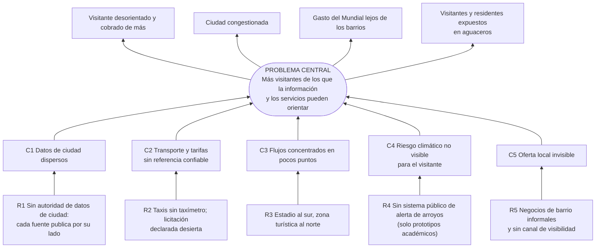
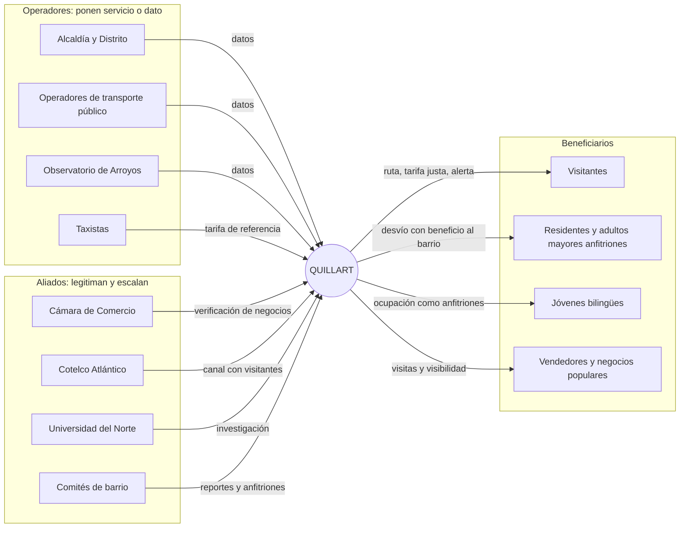

# Árbol de causas y mapa de actores

Responde al issue "Árbol de causas y mapa de actores". Criterio de la rúbrica: comprensión del problema y pertinencia (10). Todas las cifras salen de [04-cifras-verificadas.md](04-cifras-verificadas.md); lo que no está allí se marca como **por verificar**.

## 1. Árbol de causas

El problema central está en [03-diseno-actual.md](03-diseno-actual.md): en 2034 Barranquilla recibe más visitantes de los que su información y sus servicios pueden orientar. Se lee de abajo hacia arriba: causas raíz, causas directas, problema central y efectos.

### Causas, evidencia y qué parte del programa la ataca

| Causa | Cifra o evidencia verificada | Fuente | Qué la ataca |
|---|---|---|---|
| **C1 Datos de ciudad dispersos** (transporte, agenda, calendario, clima, arroyos). | Todavía no hay cifra propia. Por verificar: si Google Maps tiene tránsito de Barranquilla y el estado de la app Sibus. | — | Componente 1: datos abiertos de ciudad. |
| **C2 Transporte y tarifas sin referencia confiable.** | Taxis sin taxímetro; licitación declarada desierta. En feb 2026, carreras de 2 a 3 km cobradas a $35.000 frente a $12.000 habituales. | RTVC; Blu Radio. | Tarifa justa en la aplicación y reporte de cobros abusivos (Decisor y Guía). |
| **C3 Flujos concentrados en pocos puntos.** | El estadio está en el extremo sur y la zona turística en el norte. En el Carnaval 2026 hubo más de 820.000 visitantes con ocupación hotelera superior al 90 %, frente a más de 8.600 habitaciones y 16.000 camas. | Balance de la Alcaldía citado por Forbes Colombia; Cotelco Atlántico citado por El Heraldo. | Decisor: propone a la ciudad a dónde desviar multitudes. |
| **C4 Riesgo climático no visible.** | Más de 50 arroyos urbanos, 15 peligrosos, 9 de esos canalizados; 134 muertes en casi 100 años. No encontramos un sistema público de alerta en operación. El sur registra hasta 5 °C más de temperatura superficial que el norte. | Distrito y Observatorio de Arroyos, citados por El Heraldo (2024); Universidad del Norte, Urban Climate (2024). | Alerta de arroyos y rutas con sombra e hidratación. En la demo los datos son simulados y se dice. |
| **C5 Oferta local invisible.** | Informalidad laboral en el área metropolitana cerca de 49 % (jul – sep 2026; leído de un gráfico, confirmar). Microempresas: 94,5 % del tejido empresarial. | DANE, boletín GEIH; Cámara de Comercio de Barranquilla. | Componente 2: negocios verificados, QR de "abierto" y sellos por visita. |

### Por qué importa a escala de megaevento

Los megaeventos cuestan en promedio 172 % más de lo presupuestado (Flyvbjerg, Budzier y Lunn, 2021, citado en el deck del organizador). Sin orientación y sin datos compartidos, la ciudad paga ese sobrecosto en improvisación.

### Causas raíz: marcadas como hipótesis

R1 y R5 son lectura del equipo, no hallazgos citados. Antes de presentarlas como hecho, buscar una fuente o decir "hipótesis".

## 2. Mapa de actores

Aviso: ningún actor de esta tabla ha aceptado participar. "Rol propuesto" es lo que le pedimos, no un acuerdo. Cualquier alianza ya conseguida debe registrarse en el issue "Recursos y alianzas".

### Operadores

| Actor | Qué aporta | Qué gana | Estado |
|---|---|---|---|
| Alcaldía y Distrito | Datos abiertos, infraestructura donde van los QR (paraderos y estaciones), uso del tablero. | Un tablero para decidir desvíos y menos cobros abusivos. | Por contactar. |
| Operadores de transporte público | Horarios y tarifas. | Pasajeros orientados. | Por verificar quién opera y si hay datos. El estado de Sibus está por verificar. |
| Taxistas | Tarifa de referencia y participación voluntaria. | Evitar el conflicto con el visitante. | Por contactar. Es un actor sensible: la licitación sin taxímetro quedó desierta. |
| Observatorio de Arroyos | Información de arroyos. | Su dato llega al visitante. | Por contactar. |

### Aliados

| Actor | Rol propuesto |
|---|---|
| Cámara de Comercio de Barranquilla | Verificar y formalizar negocios populares. |
| Cotelco Atlántico | Llegar al visitante desde los hoteles. |
| Universidad del Norte | Investigación y prototipos académicos de alerta de arroyos y calor urbano. |
| Comités de barrio | Reportes, validación local y selección de anfitriones. |

### Beneficiarios

| Beneficiario | Qué recibe | Caso de uso |
|---|---|---|
| Visitante extranjero | Orientación en su idioma, ruta verde y tarifa justa. | Caso 1 |
| Visitante con movilidad reducida | Ruta accesible y alerta de arroyo. | Caso 2 |
| Adultos mayores | Rol de anfitrión y un ingreso a partir del conocimiento del barrio. | Caso 2 |
| Jóvenes bilingües | Experiencia y empleo como pareja del adulto mayor. | Caso 2 |
| Vendedores y negocios populares | Visibilidad, visitas y sellos. | Caso 3 |
| Residentes de Barrio Abajo | Que el desvío de multitudes los beneficie y no los desplace. | Caso 3 |

### Actores con intereses en tensión

| Tensión | Cómo se maneja |
|---|---|
| Taxistas frente a tarifa de referencia visible. | Presentar la tarifa como referencia y no como sanción; invitarlos como actor. |
| Residentes de Barrio Abajo frente a la llegada de multitudes. | Tope de personas desviadas y beneficio directo al barrio. Ver el issue "Desvío a Barrio Abajo sin desplazar al barrio". |
| Negocios formales frente a informales. | Verificación progresiva, sin exigir formalización para entrar. |

## 3. Pendientes de este documento

- Confirmar la cifra de informalidad (49,0 %) en el anexo de Excel del DANE.
- Buscar fuente para las causas raíz R1 y R5, o presentarlas como hipótesis.
- Confirmar quién opera el transporte público y qué datos publica.
- Pasar a "Por contactar" o "Confirmado" el estado de cada actor cuando haya conversación.
