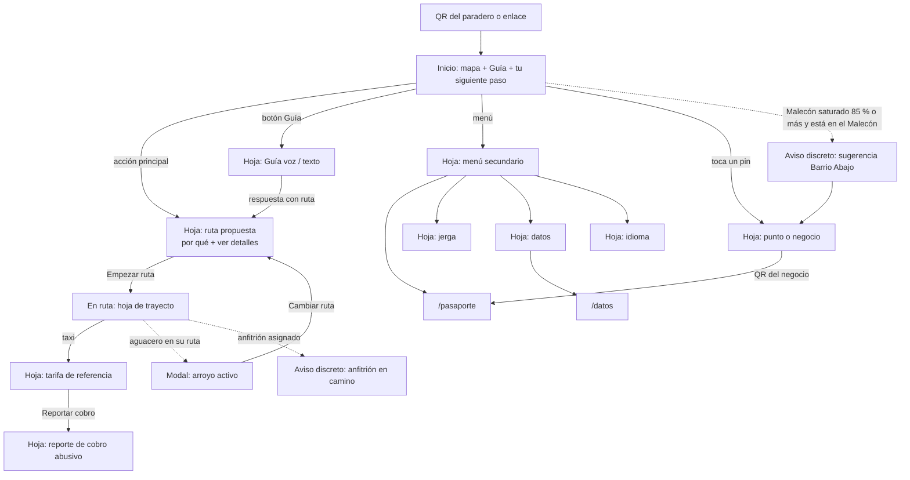
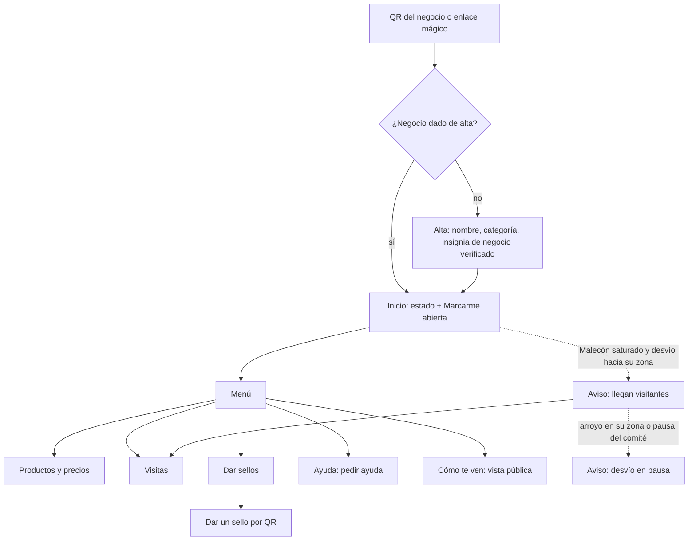
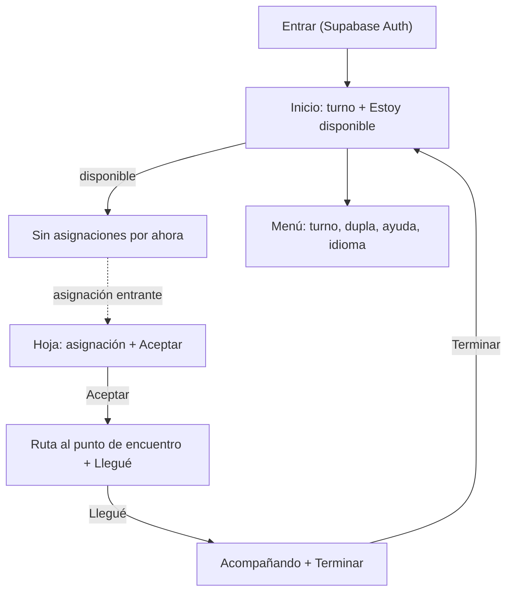
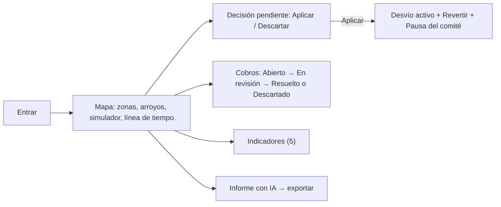
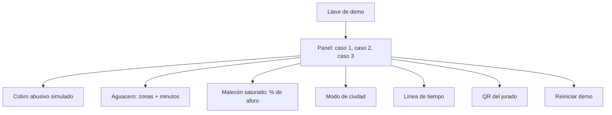

# Arquitectura de información y navegación por rol

Issue #56. Va primero en la épica #57: los demás issues construyen sobre esta estructura. Aplica al pie de la letra las 10 reglas de UX de la épica y el canal `city-events`.

Mockup navegable: (enlace pendiente)

## 1. Las 5 superficies

Cada rol ve solo lo suyo (regla 1). Una superficie es una app distinta con su propia ruta, su propio tema y su propio menú. No hay un menú que lleve de una superficie a otra.

| | Visitante | Vendedor | Anfitrión | Ciudad | Presentador |
|---|---|---|---|---|---|
| **Dispositivo** | Celular | Celular | Celular | Portátil (tablero) | Portátil o tableta (panel) |
| **Ruta** | `/` | `/vendedor` | `/anfitrion` | `/ciudad` | `/presentador` |
| **Cómo entra** | Sin registro. Abre el enlace o el QR del paradero. Idioma del navegador; se cambia en un toque | QR del negocio o enlace mágico al correo | Supabase Auth (correo y contraseña) | Supabase Auth (correo y contraseña) | Llave de demo (ver 5.4) |
| **Tema** | Claro | Claro | Claro | Oscuro | Oscuro |
| **Qué ve** | Mapa del corredor, Guía (voz o texto), una tarjeta "tu siguiente paso", avisos que le aplican, pasaporte, jerga, datos e idioma | Su negocio: abierto o cerrado, productos y precios, visitas recibidas, aviso cuando la ciudad invita visitantes a su barrio | Su turno, su dupla, la asignación entrante, la ruta al punto de encuentro, botones "Aceptar" y "Llegué" | Centro de Mando: mapa con zonas, arroyos, decisiones del Decisor, bandeja de cobros abusivos, indicadores, simulador, línea de tiempo, informe con IA | Disparadores de eventos, modo de ciudad, línea de tiempo, QR del jurado, registro de eventos enviados, reiniciar |
| **Nunca ve** | Simulador de multitudes, indicadores, informe con IA, confianza del Decisor fuera de "ver detalles", conteos por zona, otros visitantes, reportes de terceros | Datos de visitantes, otros negocios en modo edición, indicadores, simulador, alertas de zonas que no son la suya | Ubicación exacta del visitante fuera de la asignación activa, indicadores, simulador, reportes de cobro | Datos personales: solo conteos anónimos por zona (Ley 1581 de 2012) | Datos personales. No opera la ciudad: solo dispara la demo |

Notas:

- El tema claro va en las tres apps de celular porque se usan en la calle, bajo el sol. El oscuro queda para operar (ciudad y presentador). La persona puede cambiarlo; se guarda en `localStorage` (`quillart-theme`), como ya hace el mapa del corredor.
- `/mapa` (PR #58) se fusiona en `/` y redirige. La portada actual de `/` pasa al panel del presentador como lista de enlaces a las superficies.
- `/datos` (portal de datos abiertos, #53) es público y no es una superficie: se llega desde el menú del visitante y desde el Centro de Mando.

## 2. Mapa de navegación por superficie

Regla común: una sola acción principal (`.q-btn--primary`) por pantalla (regla 2). Lo secundario va en el menú o en una hoja inferior.

Regla 6 en la práctica: cada recomendación trae una frase de por qué con datos reales del corredor. Ejemplo canónico (caso 1, `visitante/c1-02-ruta`): "Evitamos el trancón de la Vía 40; esta ruta tiene sombra en los paraderos." Con aguacero (caso 2): "Evitamos el arroyo de la 46; esta ruta no tiene escaleras." No usar el ejemplo "arroyo de la 21" de la épica: ese arroyo no existe en la semilla.

**Hora canónica de la demo** (la misma en todas las pantallas y en el guion del Demo Day):

| Hora | Momento | Evento |
|---|---|---|
| 17:13 | Caso 1: el visitante envía el reporte de cobro abusivo | `cobro_abusivo` |
| 17:18 | Caso 2: cae el aguacero; arroyo activo en 12 min | `aguacero` |
| 17:45 | Caso 3: Malecón saturado (89 %) | `malecon_saturado` |

**Valores canónicos del caso 2:** arroyos activos Carrera 46 (`ARR-MURILLO-46`) y La Felicidad (`ARR-FELICIDAD`); ruta accesible segura por la Vía 40; la dupla de anfitriones es de la zona Troncal Murillo (paraderos La Arenosa y Joaquín Barrios Polo) y recibe en "Joaquín Barrios Polo, salida con rampa" (`STOP-MURILLO-SUR`); el anfitrión llega en 8 min y luego 6 min; el visitante, en 15 min y luego 12 min.

### 2.1 Visitante

**Pantalla de inicio:** mapa a pantalla completa, botón del Guía (voz o texto) y una sola tarjeta "tu siguiente paso" (`.q-next-step`) abajo.

| Elemento | Contenido |
|---|---|
| Acción principal | La del "tu siguiente paso". Sin ruta: "Pregúntale al Guía". Con ruta: "Empezar ruta". En ruta: "Ver siguiente tramo" |
| Arriba | Logo, etiqueta "datos simulados 2034" (`.q-sim-tag`), botón de idioma (un toque) y botón de menú |
| Guía | Botón flotante. Abre una hoja con voz por defecto y texto como respaldo |
| Menú secundario | Pasaporte, Jerga, Datos, Idioma. Nada más |
| Hojas inferiores | Detalle de punto o negocio, Guía, ruta, menú, idioma, jerga, datos, reporte de cobro |
| Rutas | `/` (todo es hoja sobre el mapa), `/pasaporte` (página propia porque el QR del negocio abre `/pasaporte?sello=<codigo>`) |
| Enlaces de entrada | `/?parada=STOP-CENTRO` centra el mapa en el paradero del QR. `?lang=en` fuerza idioma |

- **Pasaporte:** sellos obtenidos por QR en negocios verificados y eventos ambientales. Recompensa solo en eventos ambientales (#45).
- **Jerga:** diccionario de expresiones costeñas con su explicación (#48).
- **Datos:** qué datos usa la app, qué no se guarda (sin ubicación exacta ni datos personales), aviso de datos simulados y enlace a `/datos`.
- **Idioma:** español, inglés, portugués y francés (#48). Marca el detectado.



### 2.2 Vendedor

**Pantalla de inicio:** tarjeta "tu siguiente paso" con el estado del negocio en palabra ("Cerrado") y la acción principal "Marcarme abierta". Abierta, la acción pasa a "Marcarme cerrada" (con confirmación).

| Elemento | Contenido |
|---|---|
| Acción principal | Abrir o cerrar el negocio |
| Menú secundario | Productos y precios, Visitas, Dar sellos, Ayuda, Cómo te ven, Idioma |
| Hojas | Editar un producto, detalle de visitas del día, dar un sello por QR |
| Avisos | Discretos: "La ciudad invita visitantes a Barrio Abajo" (solo si su negocio está en la zona destino y abierto) y "Desvío en pausa" (arroyo activo en su zona o pausa del comité, reglas 5 y 6 de [14-desvio-barrio-abajo.md](14-desvio-barrio-abajo.md)) |
| Pantallas | `base-01-entrada`, `base-02-alta`, `base-03-inicio`, `base-04-menu`, `base-05-productos`, `base-06-ayuda` (pedir ayuda), `base-07-vista-publica` (cómo ve el visitante su tarjeta), `c3-01-abierta`, `c3-02-llegan-visitantes`, `c3-03-visitas`, `c3-04-dar-sello`, `c3-05-arroyo-pausa` |

"Dar sellos" es la acción del vendedor de entregar un **sello** al visitante (por QR, en los dos sentidos). No confundir con **Negocio verificado**, la insignia que el negocio recibe al darse de alta.



### 2.3 Anfitrión

**Pantalla de inicio:** estado del turno y la acción principal "Estoy disponible". Disponible y sin asignación, la pantalla muestra el estado vacío "Sin asignaciones por ahora".

| Elemento | Contenido |
|---|---|
| Acción principal | Disponible → Aceptar asignación → Llegué → Terminar |
| Menú secundario | Mi turno, Mi dupla, Ayuda, Idioma |
| Hojas | Detalle de la asignación (necesidad: silla de ruedas, idioma; punto de encuentro) |
| Zona de la demo | Troncal Murillo: paraderos La Arenosa y Joaquín Barrios Polo. Punto de encuentro: "Joaquín Barrios Polo, salida con rampa" (`STOP-MURILLO-SUR`) |
| Ayudas | Frases: frases de apoyo bilingües para la dupla |
| Avisos | Asignación entrante: notificación del sistema más hoja expandida (es parte de la respuesta a un arroyo, cuenta como seguridad). Arroyo en su zona: aviso discreto |



### 2.4 Ciudad (Centro de Mando)

**Pantalla de inicio:** mapa del corredor a la izquierda, columna de decisiones y avisos a la derecha, fila de indicadores arriba. La acción principal es la de la decisión pendiente ("Aplicar desvío"); sin decisión pendiente no hay botón primario.

| Elemento | Contenido |
|---|---|
| Acción principal | Aplicar la decisión del Decisor (con Descartar y Revertir como secundarias) |
| Navegación | Pestañas: Mapa, Cobros, Indicadores, Informe |
| Paneles | Decisión con `.q-band`, impacto, confianza en `.q-details`; bandeja de cobros (Abierto, En revisión, Resuelto, Descartado); simulador sobre el mapa; línea de tiempo abajo |
| Avisos | Arroyo activo: banda roja en el mapa y aviso en la columna. Nunca modal: la persona opera, no está en riesgo |
| Pausa del comité | El comité de barrio no usa la app: llama o escribe, y el operador de ciudad toca "Pausa del comité" en el tablero en su nombre. El registro guarda quién la pidió (persona o cargo del comité), quién la aplicó y la hora. Mientras dura, Barrio Abajo no aparece como destino |



### 2.5 Presentador

**Pantalla de inicio:** panel con los disparadores agrupados por caso. Cada botón tiene una sola acción y muestra el último envío ("Enviado hace 4 s").

| Elemento | Contenido |
|---|---|
| Acción principal | Solo el disparador del caso que se está presentando (Caso 1 → cobro abusivo, Caso 2 → aguacero, Caso 3 → Malecón saturado). Los disparadores de los otros casos son botones secundarios |
| Secundario | Modo de ciudad, línea de tiempo (reproducir), QR del jurado, enlaces a las otras superficies, reiniciar demo (con confirmación) |
| Registro | Lista de eventos enviados con hora (17:13, 17:18 y 17:45 en la demo); confirma que cada superficie reaccionó en menos de 2 s |



## 3. Avisos contextuales y presupuesto de interrupciones

Reglas 3 y 4 de la épica. Un aviso aparece solo si aplica al visitante y a su ruta. Solo un arroyo activo interrumpe. Máximo un aviso visible a la vez.

### 3.1 Qué cuenta como "su ruta" y "su zona"

- **Ruta:** las zonas que cruzan los tramos de la ruta activa (`route_segments` → `flood_zone_code` y zona de cada paradero).
- **Zona actual:** la zona del corredor más cercana a su ubicación. La ubicación se queda en el celular; nunca se envía.
- Sin ruta activa y sin permiso de ubicación: la zona del paradero del QR con el que entró (`?parada=`).

### 3.2 Reglas por aviso (visitante)

| Prioridad | Aviso | Disparador | Condición | Forma | Se va cuando |
|---|---|---|---|---|---|
| 1 | **Arroyo activo** | `aguacero` (`zoneIds`, `startsInMin`) | Algún `zoneId` está en su ruta o es su zona actual | **Modal** (`.q-alert--modal.q-alert--alert`) con cuenta regresiva "Arroyo activo en 12 min". Acción principal: "Cambiar ruta" (el Decisor ya recalculó). Secundaria: "Entendido". El modal no ofrece anfitrión: la oferta llega después, como aviso discreto `--info` en la ruta recalculada ("¿Quieres que un anfitrión te reciba?"), solo en modo accesible. Notificación del sistema si la app está en segundo plano (#47) | Toca "Cambiar ruta" o "Entendido". Después queda como banda roja en la tarjeta de ruta hasta `reiniciar` |
| 1 | Arroyo fuera de su ruta | `aguacero` | Ningún `zoneId` le aplica | Sin aviso. La zona se pinta roja en el mapa | — |
| 2 | **Anfitrión en camino / llegó** | Cambio de estado de su `host_assignments` (ver 4) | La asignación es suya | Aviso discreto `--safe`: "Tu anfitrión va en camino. Llega en 6 min" | Al pasar a "llegó" se reemplaza; al terminar se cierra solo |
| 3 | **Sugerencia de desvío** | `malecon_saturado` con `capacityPct >= 85` (respaldo en uso). Si la épica acepta `desvio` (propuesta, ver 4.2), pasa a ese evento | Está en `gran_malecon`, no tiene ruta en curso y Barrio Abajo pasa las reglas duras de [14-desvio-barrio-abajo.md](14-desvio-barrio-abajo.md) | Aviso discreto `--info`: "Barrio Abajo a 20 min a pie. 12 negocios abiertos". Acción: "Ver Barrio Abajo" | La cierra, inicia otra ruta o el Malecón baja de 85 % |
| 4 | **Reporte de cobro** | Respuesta de `/api/reports` y luego cambio de estado del reporte | Es su reporte | Aviso discreto `--safe`: "Recibimos tu reporte". Luego "Tu reporte fue resuelto" | La cierra o sale de la pantalla |
| 5 | Modo de ciudad | `modo_ciudad` | Siempre | Sin aviso. Cambia el contenido (agenda, recomendaciones) | — |
| — | Línea de tiempo | `tiempo` | — | El visitante lo ignora | — |
| — | Reiniciar | `reiniciar` | Siempre | Sin aviso. Vacía la cola y vuelve al inicio | — |

### 3.3 Cola y presupuesto

- **Máximo uno visible.** Hay un solo hueco de aviso encima de la tarjeta "tu siguiente paso". El modal también ocupa ese hueco.
- **Prioridad:** el número más bajo gana. Uno de mayor prioridad reemplaza al visible; el desplazado vuelve a la cola si no expiró.
- **Cola:** máximo 3 en espera. Si entra uno igual al que espera (mismo tipo y mismo objeto), se actualiza en lugar de sumarse.
- **Expira:** sugerencia de desvío a los 20 min, cuando `malecon_saturado` baja de 85 % o, si se acepta la propuesta, con `desvio` `active: false`; los demás cuando su estado deja de ser cierto.
- **Tiempo mínimo:** ningún aviso se cierra solo antes de 20 s (WCAG 2.2.1).
- **Un modal por evento.** Si llega otro `aguacero` para la misma zona, se actualiza la cuenta regresiva sin abrir otro modal.
- **Lector de pantalla:** discretos con `role="status"`; el modal con `role="alertdialog"` y foco en "Cambiar ruta".

### 3.4 Sin conexión

- El estado "sin conexión" no es un aviso: es una etiqueta en la cabecera ("Sin conexión") y no gasta el hueco.
- Sin Realtime no llegan eventos. La app muestra el último estado conocido de arroyos con su hora ("Actualizado hace 8 min").
- Si había un arroyo activo en su ruta antes de perder la red, la banda roja se mantiene.
- El Guía responde con las respuestas guardadas de los tres casos (#47).
- Al volver la red, la app pide el estado actual (`flood_zones`, `host_assignments` propios) y reconstruye la cola sin repetir modales ya vistos.

### 3.5 Otras superficies

| Superficie | Interrumpe con | Discreto |
|---|---|---|
| Vendedor | Nada | Llegan visitantes (desvío hacia su zona), Desvío en pausa (arroyo activo en su zona mientras había desvío, o pausa del comité; reglas 5 y 6 de [14-desvio-barrio-abajo.md](14-desvio-barrio-abajo.md)), nueva visita, sello entregado |
| Anfitrión | Asignación entrante en un arroyo (notificación + hoja expandida) | Arroyo en su zona, asignación cancelada |
| Ciudad | Nada | Arroyo activo, cobro abusivo en estado Abierto, decisión pendiente |
| Presentador | Nada | Confirmación de cada evento enviado |

## 4. Superficie × evento `city-events`

Tipos exactos de la épica #57, sin cambios:

```ts
type CityEvent =
	| { type: "aguacero"; zoneIds: string[]; startsInMin: number }
	| { type: "malecon_saturado"; capacityPct: number }
	| { type: "cobro_abusivo"; reportId: string }
	| { type: "modo_ciudad"; mode: "mundial" | "carnaval" | "cotidiano" }
	| { type: "tiempo"; hour: number } // 8 a 23, línea de tiempo
	| { type: "reiniciar" };
```

### 4.1 Quién publica, quién escucha y qué se ve

| Evento | Publica | Visitante | Vendedor | Anfitrión | Ciudad | Presentador |
|---|---|---|---|---|---|---|
| `aguacero` | Presentador (#41) | Modal si toca su ruta o zona; zona roja en el mapa; ruta recalculada sin el arroyo (#52) | Si había desvío hacia su zona y el arroyo está en ella: aviso discreto "Desvío en pausa" | Aviso discreto si es su zona | Arroyos en rojo, cuenta regresiva, rutas afectadas, simulador reacciona (#42) | Registro "enviado" |
| `malecon_saturado` | Presentador (#41) | Con `capacityPct >= 85` y si está en el Malecón: sugerencia discreta de Barrio Abajo (respaldo mientras `desvio` sea propuesta) | Con `capacityPct >= 85` y negocio abierto en Barrio Abajo: aviso "llegan visitantes" | Nada | Malecón en rojo "Saturado"; el Decisor propone desvío (#18, #10) | Registro |
| `cobro_abusivo` | Servidor, después de guardar el reporte en `/api/reports` (lo dispare el visitante o el botón del presentador) | Nada (su propio reporte se confirma por la respuesta de la API) | Nada | Nada | Nuevo reporte en la bandeja (#51); indicador de ciudadanía (#55) | Registro |
| `modo_ciudad` | Presentador (#41) | Cambia agenda y recomendaciones | Nada | Nada | Cambia umbrales y etiqueta del modo | Selector marcado |
| `tiempo` | Línea de tiempo (#44), desde el tablero o el panel | Lo ignora | Nada | Nada | Mapa, simulador e indicadores a esa hora | Deslizador sincronizado |
| `reiniciar` | Presentador (#41) | Vuelve al inicio, vacía la cola | Vuelve a su estado semilla | Sin asignaciones | Estado semilla | Registro limpio |

Reglas:

- Los tipos viven en `src/lib/city-events/city-events-types.ts` (lo crea #41). Nadie los copia.
- Todos escuchan con un solo hook: `src/lib/city-events/use-city-events.ts`.
- El canal es privado (Realtime Authorization): todos leen; solo el servidor y los roles `presenter` y `city` envían (ver 5.3).

### 4.2 Propuestas para agregar a la épica

Hacen falta para cumplir la regla 3 y los casos 2 y 3. No se usan hasta que la épica los acepte.

| Propuesta | Por qué | Alternativa si no se acepta |
|---|---|---|
| `{ type: "desvio"; fromZone: string; toZone: string; active: boolean }`, publicado por el Centro de Mando al aplicar, revertir o pausar un desvío | El visitante solo debe ver la sugerencia cuando la ciudad aplicó el desvío y el comité no lo pausó ([14-desvio-barrio-abajo.md](14-desvio-barrio-abajo.md)) | El visitante muestra la sugerencia con `malecon_saturado` y `capacityPct >= 85`, evaluando las reglas duras en su celular |

Lo que **no** va por `city-events` (es estado guardado y privado, no un aviso para todos):

- Asignaciones de anfitrión: tabla `host_assignments` con Realtime `postgres_changes` filtrado por RLS.
- Negocio abierto o cerrado: `businesses.is_open` con `postgres_changes` (#49).
- Estado de un reporte de cobro: `overcharge_reports.status` con `postgres_changes` (#51).

## 5. Plan de implementación de roles (no implementar aquí)

### 5.1 Tipo de rol

`src/lib/city-dashboard-types.ts` hoy tiene `UserRole = "visitor" | "vendor" | "city"`. Se mueve a un archivo propio y se amplía:

```ts
// src/lib/auth/auth-types.ts
export type UserRole = "visitor" | "vendor" | "host" | "city" | "presenter";

export const ROLE_HOME: Record<UserRole, string> = {
	visitor: "/",
	vendor: "/vendedor",
	host: "/anfitrion",
	city: "/ciudad",
	presenter: "/presentador",
};
```

`city-dashboard-types.ts` reexporta `UserRole` para no romper el tablero.

### 5.2 Guardia de rutas

`src/middleware.ts` con `defineMiddleware` de Astro:

| Prefijo | Roles permitidos | Sin sesión |
|---|---|---|
| `/`, `/pasaporte`, `/datos`, `/api/datos/*` | Todos | Entra como visitante |
| `/vendedor/*` | `vendor`, `city` | `/vendedor/entrar` |
| `/anfitrion/*` | `host`, `city` | `/anfitrion/entrar` |
| `/ciudad/*` | `city` | Formulario de acceso actual (`city-auth-gate.tsx`) |
| `/presentador/*` | `presenter`, `city`, o cookie de llave de demo | `/presentador/entrar` |

- La guardia es comodidad, no seguridad: la seguridad es RLS.
- Leer la sesión en el servidor exige `@supabase/ssr` (dependencia nueva) y un cliente en `src/lib/supabase-server.ts`.
- Con rol equivocado: redirige al inicio de su propio rol (`ROLE_HOME`).
- Visitante: Supabase Auth anónimo (`signInAnonymously`). Da un id por sesión sin registro (#43) y permite RLS de "lo mío" (reporte, asignación). `current_user_role()` devuelve `visitor` si no hay perfil.

### 5.3 Base de datos y RLS

Una migración nueva: `supabase/migrations/<fecha>_roles_host_presenter.sql`.

| Cambio | Detalle |
|---|---|
| `user_profiles.role` | El `check` acepta `visitor`, `vendor`, `host`, `city`, `presenter` |
| `current_user_role()` | Acepta los 5 roles desde `app_metadata` |
| `host_assignments` (tabla nueva) | `id`, `flood_zone_code`, `meeting_stop_code`, `needs` (accesible, idioma), `status` (`requested`, `accepted`, `arrived`, `done`, `cancelled`), `host_user_id`, `visitor_user_id` (anónimo), `is_simulated`, fechas. En `supabase_realtime` |
| RLS `host_assignments` | Visitante: `INSERT` y `SELECT` de las suyas. `host`: `SELECT` de las `requested` de su zona y de las suyas; `UPDATE` de `status` solo en las suyas. `city`: todo |
| RLS `businesses` | Sin cambios (el vendedor ya edita la suya) |
| RLS `overcharge_reports` | El visitante anónimo lee las suyas (agregar `reporter_user_id`) para ver "resuelto" |
| RLS `zone_visitor_counts` | `presenter` puede escribir (simulador, reiniciar) además de `city` |
| `realtime.messages` | Canal `city-events` privado: `SELECT` para `anon` y `authenticated`; `INSERT` solo `city` y `presenter` |

### 5.4 Presentador en el Demo Day

1. Variable de entorno del servidor `DEMO_PRESENTER_KEY`.
2. `/presentador/entrar` pide la llave (o la recibe en `?key=` desde un QR privado del equipo).
3. `src/pages/api/presentador/session.ts` la compara y crea una cookie `httpOnly`, `secure`, firmada, de 8 horas.
4. El panel no publica desde el navegador: llama a `src/pages/api/presentador/events.ts`, que valida la cookie y publica en `city-events` con la llave de servicio.
5. Un usuario `city` también entra al panel (lo pide #41).
6. Sin internet: el panel funciona en modo local y emite los eventos por `BroadcastChannel` entre pestañas del mismo portátil (plan B, #47).

### 5.5 Qué issue construye cada pieza

| Issue | Construye | Archivos que crea |
|---|---|---|
| #41 Presentador | Tipos y canal, panel, llave de demo, reiniciar | `src/lib/city-events/city-events-types.ts`, `src/lib/city-events/city-events-channel.ts`, `src/lib/city-events/use-city-events.ts`, `src/pages/presentador/index.astro`, `src/pages/presentador/entrar.astro`, `src/pages/api/presentador/session.ts`, `src/pages/api/presentador/events.ts`, `src/components/presenter/presenter-panel.tsx` |
| #56 (este, fase 2) | Roles y guardia | `src/lib/auth/auth-types.ts`, `src/lib/auth/role-routes.ts`, `src/middleware.ts`, `src/lib/supabase-server.ts`, migración de roles |
| #42 Simulador | Capa de multitudes en el Centro de Mando | `src/components/city/crowd-simulator.tsx`, `src/lib/crowd/crowd-sim.ts` |
| #43 QR del jurado | QR y contador de presencia | `src/components/presenter/jury-qr.tsx`, `src/lib/city-events/presence.ts` |
| #44 Línea de tiempo | Deslizador y evento `tiempo` | `src/components/city/match-timeline.tsx`, `src/lib/timeline/timeline.ts` |
| #45 Pasaporte | Sellos y página | `src/pages/pasaporte.astro`, `src/components/visitor/passport.tsx`, `src/lib/passport/passport.ts` |
| #46 Rutas frescas | Capa de calor y criterio de sombra | `src/components/map/heat-layer.ts`, cambios en `src/lib/decider/` |
| #47 Offline | PWA, caché, notificación de arroyo | `public/manifest.webmanifest`, `public/sw.js`, `src/lib/offline/offline-cache.ts` |
| #48 Idiomas y jerga | Textos en 4 idiomas, detección, jerga | `src/lib/i18n/i18n.ts`, `src/lib/i18n/messages/{es,en,pt,fr}.ts`, `src/lib/i18n/slang.ts`, `src/components/visitor/language-sheet.tsx`, `src/components/visitor/slang-sheet.tsx` |
| #49 Vendedor | Alta, abierto/cerrado, productos y precios, visitas | `src/pages/vendedor/index.astro`, `src/pages/vendedor/entrar.astro`, `src/components/vendor/*` |
| #50 Anfitrión | Asignación, aceptar, llegué | `src/pages/anfitrion/index.astro`, `src/pages/anfitrion/entrar.astro`, `src/components/host/*`, `src/lib/host/host-assignments.ts` |
| #51 Cobro abusivo | Formulario, bandeja, evento | `src/components/visitor/overcharge-sheet.tsx`, `src/components/city/overcharge-inbox.tsx`; publica `cobro_abusivo` desde `src/pages/api/reports.ts` |
| #52 Arroyos | Cuenta regresiva, modal, recálculo | `src/lib/floods/flood-alert.ts`, `src/components/visitor/flood-alert-modal.tsx` |
| #53 Datos abiertos | Portal y API | `src/pages/datos.astro`, `src/pages/api/datos/[dataset].ts` |
| #54 Informe con IA | Generar y exportar | `src/pages/api/report/impact.ts`, `src/components/city/impact-report.tsx` |
| #55 Indicadores | 5 tarjetas en vivo | `src/components/city/kpi-row.tsx`, `src/lib/kpi/kpi.ts` |
| Común (visitante) | Inicio, cola de avisos, menú | `src/components/visitor/visitor-home.tsx`, `src/components/visitor/next-step-card.tsx`, `src/components/visitor/secondary-menu.tsx`, `src/lib/notices/notice-queue.ts` (reglas de la sección 3, con pruebas) |

## 6. Glosario

Regla 10: el mismo término para lo mismo en toda la app. Si un término no está aquí, se agrega antes de usarlo.

| Español | Inglés | Qué es | Dónde |
|---|---|---|---|
| Guía | Guide | El asistente que responde por voz o texto | Visitante |
| Respuestas guardadas | Saved answers | Lo que el Guía responde sin conexión (los tres casos) | Visitante |
| Tu siguiente paso | Your next step | La única tarjeta de acción del inicio | Visitante, vendedor, anfitrión |
| Ruta verde | Green route | Ruta en transporte público, a pie o en bici | Visitante, ciudad |
| Ruta accesible | Accessible route | Ruta sin escaleras ni tramos no accesibles | Visitante, ciudad |
| Modo accesible | Accessible mode | Preferencia que pide solo rutas accesibles | Visitante |
| Tarifa de referencia | Reference fare | Precio oficial esperado de un trayecto | Visitante, ciudad |
| Taxi verificado | Verified taxi | Conductor con QR registrado | Visitante |
| Cobro abusivo | Overcharge | Cobro por encima de la tarifa de referencia | Visitante, ciudad |
| Reporte | Report | Lo que envía el visitante sobre un cobro abusivo | Visitante, ciudad |
| Abierto / En revisión / Resuelto / Descartado | Open / In review / Resolved / Dismissed | Estados del reporte; los mismos de `REPORT_STATUS_LABELS` en `src/lib/city-dashboard-utils.ts`. No usar "nuevo" | Visitante, ciudad |
| Arroyo | Arroyo (flash flood) | Corriente de agua en la calle durante un aguacero | Todas |
| Arroyo activo | Active arroyo | Arroyo con agua ahora o en minutos | Todas |
| Aguacero | Downpour | Lluvia fuerte que activa arroyos | Presentador, ciudad |
| Anfitrión | Host | Persona del barrio que recibe y acompaña al visitante | Todas |
| Dupla de anfitriones | Host pair | Adulto mayor y joven bilingüe que trabajan juntos | Anfitrión, ciudad |
| Asignación | Assignment | Pedido de acompañar a un visitante, con necesidad y punto de encuentro | Anfitrión, ciudad |
| Turno | Shift | Franja en que el anfitrión está disponible | Anfitrión |
| Frases | Phrases | Frases de apoyo bilingües para la dupla al recibir al visitante | Anfitrión |
| Punto de encuentro | Meeting point | Paradero donde el anfitrión recibe al visitante | Visitante, anfitrión |
| Paradero | Stop | Estación o parada del corredor | Visitante |
| Negocio verificado | Verified business | Insignia del negocio de barrio que se dio de alta y fue verificado. No es un sello | Visitante, vendedor |
| Productos y precios | Products and prices | Lo que vende el negocio y cuánto cuesta. No se llama "menú" para no confundirlo con el menú de la app | Visitante, vendedor |
| Menú | Menu | El menú secundario de la app; nunca la carta de un negocio | Todas |
| Abierto / Cerrado | Open / Closed | Estado del negocio que marca el vendedor | Visitante, vendedor |
| Sello | Stamp | Marca que el visitante guarda en su pasaporte al visitar un negocio verificado o un evento ambiental (QR). No es la insignia de verificado | Visitante, vendedor |
| Dar sellos | Give stamps | Acción del vendedor de entregar un sello por QR | Vendedor |
| Recompensa | Reward | Premio por sellos; solo en eventos ambientales | Visitante |
| Pasaporte | Passport | Colección de sellos del visitante en negocios verificados y eventos ambientales. **Propuesta, la detalla #45** | Visitante |
| Evento ambiental | Green event | Actividad de reciclaje o cuidado; la única con recompensa | Visitante |
| Jerga | Slang | Expresiones costeñas con su explicación | Visitante |
| Sugerencia | Suggestion | Invitación a ir a otra zona; nunca una orden | Visitante |
| Desvío | Diversion | Decisión de la ciudad de invitar gente a otra zona | Ciudad, vendedor |
| Pausa del comité | Committee pause | El comité de barrio detiene el desvío; el operador de ciudad la aplica en su nombre | Ciudad |
| Desvío en pausa | Diversion paused | Aviso al vendedor: no llegan visitantes por arroyo activo o pausa del comité | Vendedor |
| ○ Fluido | Flowing | Zona por debajo del 60 % del umbral. Verde, halo continuo | Ciudad |
| ◐ Moderado | Moderate | Entre 60 % y 85 %. Oro, halo discontinuo | Ciudad |
| ● Saturado | Saturated | 85 % o más. Rojo, halo punteado. Siempre palabra + glifo + trazo, nunca solo color | Ciudad |
| Registro | Log | Lista de eventos enviados con hora en el panel, y de pausas del comité en el tablero | Presentador, ciudad |
| Llave de demo | Demo key | Clave que abre el panel de presentador en el Demo Day | Presentador |
| Modo de ciudad: Mundial, Carnaval, Cotidiano | City mode: World Cup, Carnival, Everyday | Escenario que cambia umbrales y contenido | Ciudad, presentador |
| Centro de Mando | Command Center | El tablero de la ciudad en `/ciudad` | Ciudad |
| Decisor | Decider | Agente que elige rutas y propone desvíos; el visitante no ve su nombre | Ciudad |
| Ver detalles | See details | Bloque plegable con probabilidades y confianza | Visitante, ciudad |
| Datos simulados 2034 | Simulated 2034 data | Etiqueta única por pantalla | Todas |
| Sin conexión | Offline | El celular no tiene internet | Todas |

## 7. Guion de prueba rápida (criterio 6)

Meta: 2 personas ajenas al equipo completan el caso 1 sin ayuda. Resultados en [feedback.md](feedback.md), sección "Validación con personas ajenas al equipo".

**Preparación (5 min)**

- Celular con la app en `/` y el idioma del navegador en inglés (o el de la persona).
- Datos semilla; ningún evento activo (`reiniciar`).
- Quien observa no toca el celular ni explica. Solo lee la consigna.
- Pedir permiso para tomar notas. No se guarda nombre.

**Consigna (se lee igual a las dos personas)**

> Estás en el Gran Malecón y tu partido empieza en una hora. Usa la app para llegar al estadio gastando poco. Después, imagina que un taxista te cobró 35.000 pesos por un trayecto corto y avísalo.

**Tareas y criterio de éxito**

| # | Tarea | Éxito si | Límite |
|---|---|---|---|
| 1 | Entender dónde está y qué hace la app | Dice en voz alta qué ofrece la pantalla de inicio | 30 s |
| 2 | Preguntar cómo llegar al estadio, en su idioma | Usa el Guía (voz o texto) sin buscar un menú | 1 min |
| 3 | Elegir la ruta verde | Toca la acción principal y explica el "por qué" con sus palabras | 1 min |
| 4 | Ver cuánto debería costar un taxi | Encuentra la tarifa de referencia | 1 min |
| 5 | Reportar el cobro abusivo | Envía el reporte y ve la confirmación | 2 min |
| 6 | Cambiar el idioma | Lo hace en un toque desde el inicio | 30 s |

Caso completado: tareas 2, 3 y 5 sin ayuda.

**Qué observar**

- Dónde duda más de 5 s o vuelve atrás.
- Si abre el menú buscando algo que debería estar en el inicio.
- Si entiende "tarifa de referencia", "ruta verde" y "datos simulados 2034".
- Si nota la etiqueta de datos simulados sin que se le diga.
- Si toca algo de menos de 44 px o falla un toque.

**Al final (2 preguntas)**

1. ¿Qué fue lo más confuso?
2. ¿Le confiarías esta app en un día de partido? ¿Por qué?

**Registro:** una fila por persona en [feedback.md](feedback.md) con perfil sin nombre, caso probado, qué entendió y qué falló, y el ajuste que se hará. Cada ajuste se convierte en un issue o en un comentario en el PR que lo corrige.
