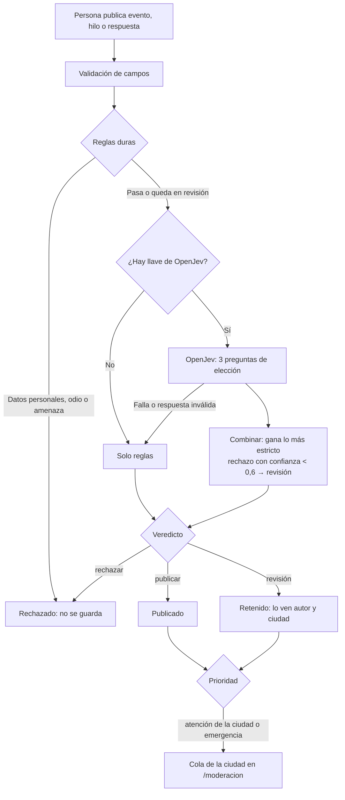

# Comunidad y moderación por triaje

Fecha: 27 nov 2026. Rama: `ccr-4d25b120-swburf`. Épica: "Plataforma ciudadana real con Quillart AI como puerta de entrada" (ver [02-decisiones.md](02-decisiones.md)).

## Propósito

QUILLART deja de ser una demo del corredor y pasa a ser un **entorno real** donde residentes de Barranquilla y visitantes:

- publican sus propios eventos y se inscriben en los de otros, con cupos;
- abren conversaciones en un foro y responden;
- descubren espacios públicos, parques y naturaleza de la ciudad;
- avisan a la ciudad de problemas en el espacio público.

Nada de lo que escribe una persona se publica sin pasar por el **triaje de moderación**: reglas duras primero y OpenJev después, el mismo patrón del Decisor (ver [13-openjev.md](13-openjev.md)).

## Usuarios

| Usuario | Qué hace | Cuenta |
|---|---|---|
| Visitante o residente sin cuenta | Navega agenda, foro y lugares; conversa con Quillart AI. | No necesita |
| Persona con cuenta | Publica eventos, se inscribe, abre conversaciones y responde. | Correo y contraseña en Supabase Auth; perfil con nombre visible y barrio opcional; marca "soy visitante" |
| Organizador | Ve quién se inscribió en sus eventos y puede cancelarlos. | La misma cuenta |
| Equipo de la ciudad (rol `city`) | Revisa la cola de moderación: aprueba o retira contenido retenido y cierra reportes. | Rol `city` en `user_profiles` |

Regla de producto: **navegar sin cuenta; cuenta solo para participar** (regla 5 de la épica #57, actualizada).

## Funciones

| Ruta | Qué hay |
|---|---|
| `/agenda` | Próximos eventos, filtros por categoría y fecha, actualización en vivo. |
| `/agenda/nuevo` | Publicar un evento: título, descripción, categoría, inicio y fin, lugar del catálogo o dirección, cupos, gratis o con valor. |
| `/agenda/<id>` | Detalle, cupos restantes, inscribirse o cancelar la inscripción; el organizador ve sus inscritos. |
| `/foro` y `/foro/<id>` | Conversaciones por categoría (General, Visitantes, Mi barrio, Naturaleza, Movilidad, Cultura, Seguridad) y respuestas. |
| `/lugares` y `/lugares/<slug>` | Catálogo de espacios públicos y naturaleza con eventos y conversaciones del lugar. |
| `/perfil` | Cuenta, nombre visible, barrio, mis inscripciones y mis publicaciones (con su estado de moderación). |
| `/moderacion` | Cola de la ciudad (solo rol `city`). |

Categorías de evento: Cultura, Música y baile, Naturaleza, Deporte, Voluntariado, Gastronomía, Talleres, Encuentro vecinal.

## Arquitectura

```
Navegador (React)
  ├── Lecturas ──────────────► Supabase (RLS oculta lo retenido a terceros; Realtime)
  ├── Inscripciones ─────────► Supabase con la sesión de la persona (trigger de cupos)
  └── Publicar evento/hilo/respuesta
          │
          ▼
  POST /api/community/publish  (servidor, verifica el token de la persona)
          │  triaje: reglas duras → OpenJev → combinación
          ▼
  Supabase con llave de servicio (inserta publicado o retenido; rechazado no se guarda)
```

| Pieza | Archivo |
|---|---|
| Esquema, RLS y triggers | `supabase/migrations/20261127000001_community_schema.sql` |
| Semilla (lugares, agenda inicial, hilo de bienvenida) | `supabase/seed-community.sql` |
| Triaje | `src/lib/moderation/` (`moderation-rules.ts`, `triage.ts`, `moderation-types.ts`, `triage.test.ts`) |
| Capa de datos | `src/lib/community/` (`community-store.ts` elige `cloud-community-store.ts` o `device-community-store.ts`) |
| Servidor | `src/lib/community/community-server.ts` y `src/lib/supabase-admin.ts` |
| API | `src/pages/api/community/publish.ts`, `triage.ts`, `moderation.ts` |

**Almacén en la nube y almacén del dispositivo.** Con `PUBLIC_SUPABASE_URL` y `PUBLIC_SUPABASE_PUBLISHABLE_KEY` la comunidad es compartida por todos (Supabase + Realtime). Sin ellas, funciona en el navegador de cada persona (almacén del dispositivo) y la moderación sigue corriendo: `POST /api/community/triage` (reglas + OpenJev, sin guardar nada) o, si no responde, las reglas duras en el propio navegador.

## Triaje de moderación



### 1. Reglas duras (`moderation-rules.ts`)

Corren primero, en el servidor y en el navegador, y **siempre ganan**. El texto se normaliza (sin tildes, minúsculas, `0`→`o`, `@`→`a`, letras repetidas comprimidas) para que "imbeciiiil" coincida con "imbecil".

| Regla | Detecta | Resultado | Etiqueta |
|---|---|---|---|
| Datos personales (Ley 1581 de 2012) | Celular colombiano, correo, número de documento | Rechazo | `personal_data` |
| Odio | Insultos discriminatorios y llamados a matar | Rechazo | `hate` |
| Amenaza | "te voy a matar", "te voy a buscar"… | Rechazo | `threat` |
| Insulto directo | Groserías fuertes (la jerga costeña amistosa no está en la lista) | Revisión | `harassment` |
| Publicidad | Más de 2 enlaces o frases de estafa ("inversión garantizada", "bitcoin"…) | Revisión | `spam` |
| Problema en el espacio público | Arroyo, inundación, hueco, cable caído, cobro abusivo, robo… | Prioridad `city_attention` | — |
| Posible emergencia | Herido, incendio, arrastrado, atrapado, persona perdida… | Prioridad `emergency` | — |

Las reglas también producen **señales** cortas en inglés (por ejemplo "contains 1 insult word(s)") que viajan a OpenJev; nunca el dato personal.

### 2. OpenJev (`triage.ts`)

Si las reglas no rechazaron y hay `TYPESAFE_API_KEY`, se llama a `client.decide(...)` con el tipo de contenido, título, texto (hasta 2.000 caracteres) y señales, y tres preguntas de elección:

| Pregunta | Opciones |
|---|---|
| `verdict` | `publish` (respetuoso, aunque critique), `review` (dudoso: posible insulto, publicidad, desinformación o fuera de tema), `reject` (acoso claro, odio, amenaza, sexual o estafa) |
| `label` | `ok`, `harassment`, `hate`, `threat`, `sexual`, `spam`, `scam`, `off_topic` |
| `priority` | `none`, `city_attention` (problema en el espacio público), `emergency` (alguien puede estar en peligro ahora) |

La instrucción le dice a OpenJev que la jerga caribeña es normal y amistosa.

### 3. Combinación

- **Veredicto:** gana el más estricto entre reglas y OpenJev (`publish` < `review` < `reject`).
- **Rechazo dudoso:** si OpenJev dice `reject` con confianza menor a **0,6** (`MIN_REJECT_CONFIDENCE`), se convierte en `review`: decide una persona.
- **Etiquetas:** se unen las de las reglas y la de OpenJev.
- **Prioridad:** gana la más alta.
- **Mensaje al autor (en español):** "Publicado.", "Tu mensaje quedó en revisión…" o "Este mensaje no cumple las normas…". Si la prioridad es de ciudad y se publica, se agrega "También lo compartimos con el equipo de la ciudad". Si es emergencia, siempre se agrega "Si alguien está en peligro, llama ya a la Línea de Emergencias 123".

### 4. Respaldo

Sin llave de OpenJev, si la API falla, se demora (timeout del cliente) o responde algo inválido, decide **solo con reglas** (`source: "rules"`). La comunidad nunca se detiene por OpenJev.

### Qué se guarda

| Veredicto | `moderation_status` | Quién lo ve |
|---|---|---|
| publicar | `published` | Todos |
| revisión | `held` | Autor (u organizador) y rol `city` |
| rechazar | No se guarda | Nadie; el autor ve el motivo y puede corregir |

Cada registro guarda `moderation_labels`, `moderation_source` (`rules`, `openjev` o `moderator`), `triage_priority` y `city_resolved_at`.

## Cola de la ciudad (`/moderacion`)

`GET /api/community/moderation` (solo rol `city`) devuelve eventos, hilos y respuestas que están **retenidos** o que están **publicados con prioridad sin cerrar**. Orden: emergencias primero, luego atención de la ciudad, luego el resto; dentro de cada grupo, lo más reciente arriba.

Acciones (`POST /api/community/moderation`):

| Acción | Efecto |
|---|---|
| `approve` | Pasa a `published`, fuente `moderator`. Una respuesta aprobada suma al contador del hilo. |
| `remove` | Pasa a `removed`, fuente `moderator`. |
| `resolve` | Marca `city_resolved_at`: la ciudad atendió el reporte. |

## Privacidad (Ley 1581 de 2012)

- El perfil público es solo nombre visible y barrio opcional.
- Las inscripciones las ven solo la persona y el organizador del evento.
- Teléfonos, correos y números de documento se rechazan en las reglas y **nunca se envían a OpenJev**.
- A OpenJev solo va el texto público que la persona quiere publicar, sin autor ni cuenta.
- La llave de servicio (`SUPABASE_SERVICE_ROLE_KEY`) vive solo en el servidor y solo la usan rutas que verifican primero el token de la persona.

## Cómo ponerlo en marcha

1. En el SQL Editor de Supabase, después de las migraciones del corredor ([11-modelo-datos.md](11-modelo-datos.md)), ejecutar `supabase/migrations/20261127000001_community_schema.sql`.
2. Ejecutar `supabase/seed-community.sql` (idempotente): lugares de la ciudad, agenda inicial de "Agenda QUILLART" con fechas relativas a hoy y un hilo de bienvenida.
3. En `.env` (y en Dokploy):
   - `PUBLIC_SUPABASE_URL` y `PUBLIC_SUPABASE_PUBLISHABLE_KEY`.
   - `SUPABASE_SERVICE_ROLE_KEY`: solo servidor; sin ella la comunidad funciona solo en el dispositivo.
   - `TYPESAFE_API_KEY`: OpenJev; sin ella el triaje usa solo reglas.
   - `GEMINI_API_KEY`: Quillart AI (ver [21-quillart-ai.md](21-quillart-ai.md)).
4. En Authentication de Supabase, habilitar registro con correo.
5. Dar rol de ciudad a quien modera: insertar su `user_id` en `public.user_profiles` con `role = 'city'`.
6. Probar: publicar un evento normal (se publica), uno con un celular (rechazado), uno con una grosería (retenido) y uno que mencione un arroyo crecido (publicado y en la cola de la ciudad).

## Límites conocidos

- Las listas de términos son cortas y en español; no cubren otros idiomas ni todas las variantes.
- OpenJev es un experimento gratuito que puede cambiar o cerrar (ver [13-openjev.md](13-openjev.md)); el respaldo por reglas es obligatorio.
- Un organizador no puede editar su evento después de publicarlo; solo cancelarlo.
- Las personas no pueden reportar contenido ya publicado; solo la ciudad retira.
- El almacén del dispositivo no se comparte entre personas: sirve para probar sin Supabase, no para operar.

## Por construir

- Reportar contenido publicado por parte de las personas, que entra a la misma cola.
- Recordatorios y notificaciones de eventos a los inscritos.
- Editar eventos con nuevo triaje.
- Multilenguaje de la comunidad y de Quillart AI (ver #48).
- Ampliar las listas de reglas con lo que aparezca en la cola, y medir cuánto acierta OpenJev frente a la decisión de la persona moderadora.
