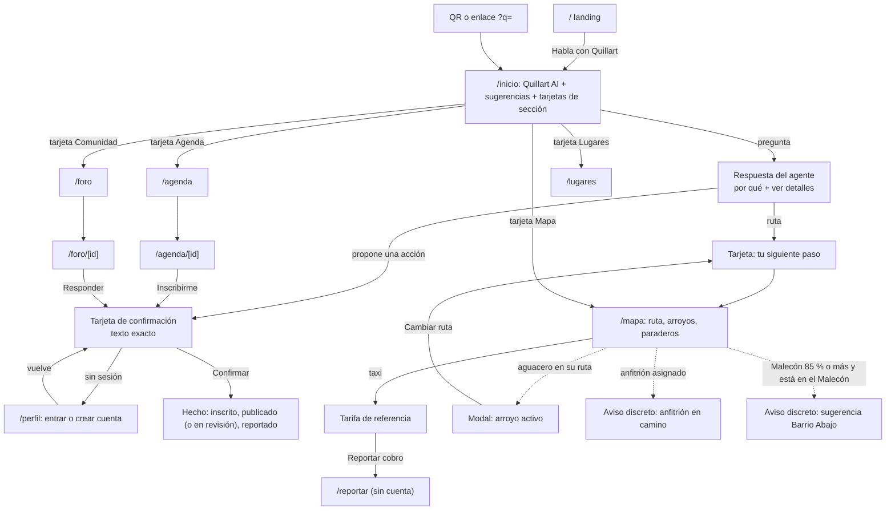
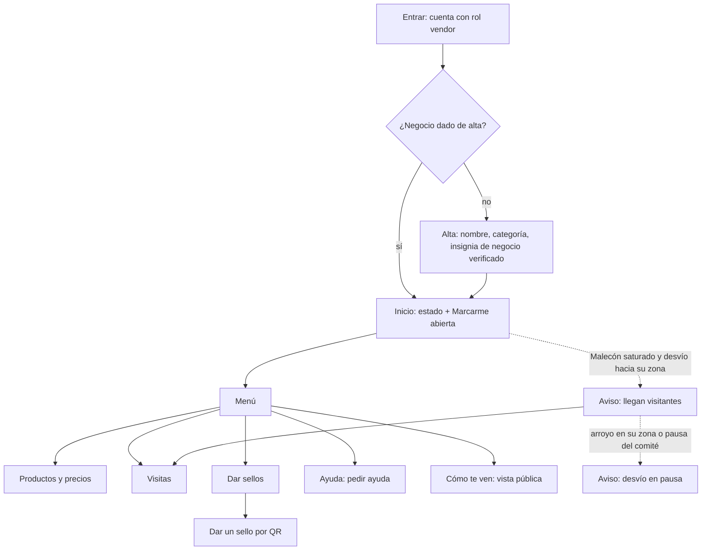
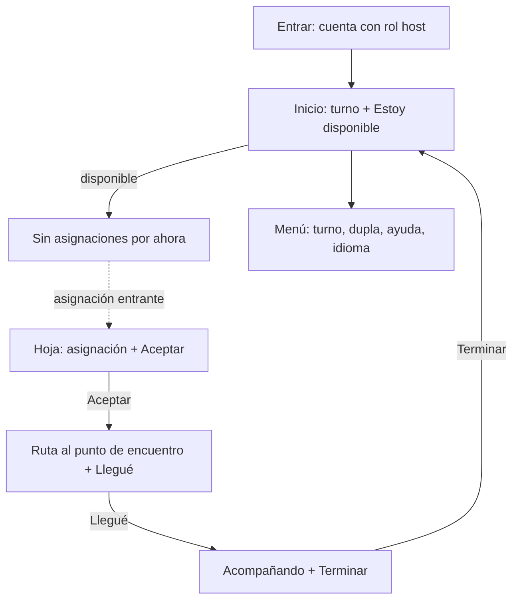
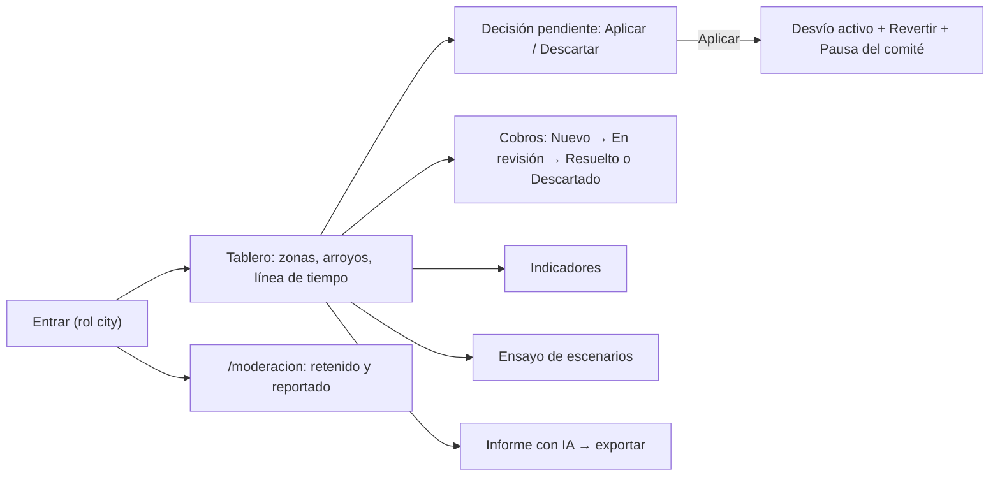
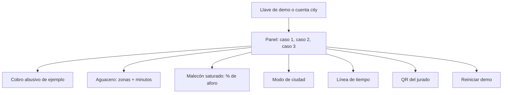

# Arquitectura de información y navegación por rol

Issue #56, alineado con `main` en #140. Escrito primero en #137 para la épica #57 y reescrito con la dirección del 27 nov 2026 (épica #79): Quillart AI es la puerta de entrada, se navega sin cuenta, el contenido de las personas es real y la semilla del corredor se marca como "datos de referencia". Aplica las 10 reglas de UX de #57 con las reglas 2, 5 y 9 actualizadas, las dos reglas nuevas de #79 y el canal `city-events`.

Mockup navegable de #137 (privado, pide acceso): <https://claude.ai/artifact/YWGGMKgDiVeaPgyXqwfkmQ>. Es anterior al 27 nov: sirve de referencia para vendedor, anfitrión, ciudad y presentador, pero las pantallas del visitante cambiaron (ver la sección 0).

Numeración: este documento usa el 26 según la propuesta de #141 (20 y 21 están repetidos; 23 a 25 quedan para los documentos que #141 renumera).

## 0. Qué cambió frente a #137

| Tema | #137 (26 nov) | Ahora (27 nov, `main`) |
|---|---|---|
| Inicio de la persona | Mapa a pantalla completa, botón del Guía y tarjeta "tu siguiente paso" en `/` | Conversación con Quillart AI en `/inicio`. `/` es la landing pública. El mapa es un apartado (`/mapa`) y una tarjeta de sección dentro del inicio |
| Guía | Asistente de voz o texto sobre el mapa | Quillart AI: orquestador con seis agentes; la voz es solo el conducto ([28-quillart-ai.md](28-quillart-ai.md)) |
| Entrada | "Sin registro" | Se navega sin cuenta; la cuenta se pide solo para participar (regla 5) |
| Etiqueta de datos | "datos simulados 2034" (`.q-sim-tag`) | "Datos de referencia", solo sobre la semilla del corredor; el contenido de las personas no se marca (regla 9) |
| Simulador | "Simulador de multitudes" | "Ensayo de escenarios", solo en el tablero de la ciudad |
| Tablero de la ciudad | "Centro de Mando" | "Lo que la ciudad aprende" ([20-identidad.md](20-identidad.md)) |
| Guardia de roles | Crear `src/middleware.ts` | Sumarse al `src/middleware.ts` existente (cabeceras de seguridad) |
| Roles | `visitor \| vendor \| host \| city \| presenter` | `user_profiles.role` (`visitor`, `vendor`, `city`) + `profiles` de la comunidad + `is_verified_organizer`; `host` y `presenter` quedan como propuesta |
| Estados del reporte de cobro | Abierto, En revisión, Resuelto, Descartado | Nuevo, En revisión, Resuelto, Descartado (`REPORT_STATUS_LABELS`, decisión de #142) |

Pantallas del mockup que cambiaron: todas las del visitante (inicio, Guía, menú, ruta, reporte y avisos sobre el mapa) y la etiqueta de datos en las de la ciudad. Las de vendedor, anfitrión y presentador siguen como referencia, salvo la etiqueta de datos.

## 1. Las 5 superficies

Cada rol ve solo lo suyo (regla 1). Una superficie es una app distinta con su propia ruta, su propio tema y su propio menú. No hay un menú que lleve de una superficie a otra.

| | Persona (vecino o visitante) | Vendedor | Anfitrión | Ciudad | Presentador |
|---|---|---|---|---|---|
| **Estado en `main`** | Construida | Pendiente (#49) | Pendiente (#50) | Construida | Pendiente (#41) |
| **Dispositivo** | Celular | Celular | Celular | Portátil (tablero) | Portátil o tableta (panel) |
| **Ruta** | `/inicio` (la landing `/` lleva ahí) | `/vendedor` | `/anfitrion` | `/ciudad` y `/moderacion` | `/presentador` |
| **Cómo entra** | Sin cuenta. Enlace, QR o landing. La cuenta (correo y contraseña) solo para participar | Cuenta con `user_profiles.role = 'vendor'`; QR del negocio o enlace mágico como propuesta | Cuenta con rol `host` (propuesta) | Cuenta con `user_profiles.role = 'city'` | Llave de demo o cuenta `city` (ver 5.5) |
| **Tema** | Claro | Claro | Claro | Oscuro (objetivo) | Oscuro |
| **Qué ve** | Quillart AI con sugerencias, tarjetas de sección (Agenda, Comunidad, Lugares, Mapa), tarjetas de confirmación, agenda, foro, lugares, mapa del corredor, reporte de cobro, perfil, avisos que le aplican | Su negocio: abierto o cerrado, productos y precios, visitas, aviso cuando la ciudad invita visitantes a su barrio | Su turno, su dupla, la asignación entrante, la ruta al punto de encuentro, "Aceptar" y "Llegué" | Mapa con zonas y arroyos, decisiones del Decisor, bandeja de cobros abusivos, cola de moderación, indicadores, Ensayo de escenarios, QR del jurado, informe con IA | Disparadores de eventos, modo de ciudad, línea de tiempo, QR del jurado, registro de eventos enviados, reiniciar |
| **Nunca ve** | Ensayo de escenarios, indicadores, informe con IA, cola de moderación, contenido retenido de otros, confianza del Decisor fuera de "ver detalles", conteos por zona, reportes de terceros | Datos de visitantes, otros negocios en edición, indicadores, Ensayo de escenarios, alertas de zonas que no son la suya | Ubicación exacta del visitante fuera de la asignación activa, indicadores, Ensayo de escenarios, reportes de cobro | Datos personales: solo conteos anónimos por zona (Ley 1581 de 2012). En moderación ve el texto retenido, nunca correos ni contraseñas | Datos personales. No opera la ciudad: solo dispara la demo |

Notas:

- El tema claro va en las tres apps de celular porque se usan en la calle, bajo el sol. La persona puede cambiarlo con el conmutador de tema; se guarda en `localStorage` (`quillart-theme`).
- `/datos` (portal de datos abiertos, #53, pendiente) es público y no es una superficie: se llega desde el perfil o el menú secundario y desde el tablero.
- `/prueba-guia` es la beta de Gemini Live: interna, no aparece en la navegación.

### 1.1 Páginas en `main`

| Ruta | Qué es | Cuenta | Superficie |
|---|---|---|---|
| `/` | Landing pública: Quillart AI como puerta de entrada, agentes, cómo funciona, próximos eventos, confianza | No | Pública |
| `/inicio` | Quillart AI: conversación por texto o voz, sugerencias, tarjetas de sección. `?q=` empieza con una pregunta | No para conversar; sí para confirmar acciones | Persona |
| `/agenda`, `/agenda/[id]` | Agenda de eventos y detalle | No para mirar; sí para inscribirse | Persona |
| `/agenda/nuevo` | Publicar un evento (pasa por triaje) | Sí | Persona |
| `/foro`, `/foro/[id]` | Comunidad: conversaciones por barrio y tema, enlazadas a lugares o eventos; respuestas. Los reportes ciudadanos de riesgo muestran "sin confirmar" hasta que la ciudad los confirma | No para leer; sí para abrir, responder o reportar | Persona |
| `/lugares`, `/lugares/[slug]` | Lugares y naturaleza | No | Persona |
| `/mapa` | Mapa del corredor: paraderos, rutas, arroyos, tarifa de referencia | No | Persona |
| `/reportar` | Reporte de cobro abusivo (anónimo, sin nombre ni teléfono) | No | Persona |
| `/perfil` | Entrar o crear cuenta, mis inscripciones y publicaciones, mis datos (descargar o borrar) | Muestra el acceso si no hay sesión | Persona |
| `/ciudad` | Lo que la ciudad aprende (tablero) | Sí, rol `city` | Ciudad |
| `/moderacion` | Cola de moderación: lo retenido por el triaje, los reportes de contenido (3 reportes ocultan) y los reportes ciudadanos de riesgo por confirmar | Sí, rol `city` | Ciudad |
| `/prueba-guia` | Beta de Gemini Live | No (interna) | — |

### 1.2 Entrada sin cuenta, cuenta solo para participar (regla 5)

Tres capas que no se mezclan:

| Capa | Dónde vive | Quién la tiene | Qué habilita |
|---|---|---|---|
| **Sin cuenta** | Nada guardado (presencia anónima con id temporal en `sessionStorage`) | Cualquiera | Conversar con Quillart AI, mirar agenda, foro, lugares y mapa, planear rutas, reportar un cobro abusivo |
| **Cuenta de la comunidad** | Supabase Auth + `public.profiles` (`display_name`, `neighborhood`, `is_visitor`), creada por el disparador `handle_new_community_user` | Quien se registra en `/perfil` | Participar: inscribirse, publicar eventos, abrir conversaciones, responder, reportar contenido, descargar o borrar sus datos |
| **Organizador verificado** | `profiles.is_verified_organizer`, que solo la ciudad cambia con la llave de servicio; se copia a `events.organizer_verified` | Organizadores que la ciudad verificó | Insignia en sus eventos; sus eventos con costo no van a revisión por la política de confianza ([22-seguridad-y-confianza.md](22-seguridad-y-confianza.md)) |
| **Rol operativo** | `public.user_profiles.role` (`visitor`, `vendor`, `city`), leído por `current_user_role()` (perfil primero, luego `app_metadata`) | Asignado por la ciudad | `city`: tablero, moderación, escribir lugares y semilla. `vendor`: editar su negocio. Sin fila: `visitor` |

Reglas de interfaz:

- Ninguna pantalla de lectura pide cuenta. El acceso aparece solo en el momento de participar.
- Cuando Quillart AI propone una acción y no hay sesión, la tarjeta de confirmación muestra el texto exacto y cambia "Confirmar" por "Inicia sesión"; al volver, la conversación sigue ahí (ya en `action-confirm-card.tsx`).
- En agenda y foro, el botón de participar lleva a `/perfil?volver=<ruta>` (`signInHref()` en `use-community.ts`) y regresa a la pantalla donde estaba.
- Una cuenta de la comunidad y un rol operativo son cosas distintas: una persona de la ciudad tiene las dos; un vecino solo la primera.

## 2. Mapa de navegación por superficie

Regla común: una sola acción principal (`.q-btn--primary`) por pantalla (regla 2). Lo secundario va en el menú, en una hoja inferior o en una tarjeta de sección.

Regla 6 en la práctica: cada recomendación trae una frase de por qué con datos reales del corredor. Ejemplo canónico (caso 1): "Evitamos el trancón de la Vía 40; esta ruta tiene sombra en los paraderos." Con aguacero (caso 2): "Evitamos el arroyo de la 46; esta ruta no tiene escaleras." No usar el ejemplo "arroyo de la 21" de la épica: ese arroyo no existe en la semilla.

**Hora canónica de la demo** (la misma en todas las pantallas y en el guion del Demo Day):

| Hora | Momento | Evento |
|---|---|---|
| 17:13 | Caso 1: la persona envía el reporte de cobro abusivo | `cobro_abusivo` |
| 17:18 | Caso 2: cae el aguacero; arroyo activo en 12 min | `aguacero` |
| 17:45 | Caso 3: Malecón saturado (89 %) | `malecon_saturado` |

**Valores canónicos del caso 2:** arroyos activos Carrera 46 (`ARR-MURILLO-46`) y La Felicidad (`ARR-FELICIDAD`); ruta accesible segura por la Vía 40; la dupla de anfitriones es de la zona Troncal Murillo (paraderos La Arenosa y Joaquín Barrios Polo) y recibe en "Joaquín Barrios Polo, salida con rampa" (`STOP-MURILLO-SUR`); el anfitrión llega en 8 min y luego 6 min; el visitante, en 15 min y luego 12 min.

### 2.1 Persona (vecino o visitante)

**Pantalla de inicio (`/inicio`):** la conversación con Quillart AI. Mientras la conversación está vacía, debajo van las sugerencias y las tarjetas de sección.

| Elemento | Contenido |
|---|---|
| Acción principal | Escribir o hablar con Quillart AI (el campo de mensaje). Una sugerencia tocada cuenta como mensaje |
| Arriba | Logo, conmutador de tema, idioma (un toque, #48 y PR #139) y acceso a Perfil en escritorio |
| Sugerencias | "Planes para este fin de semana", "Quiero publicar un evento", "Lugares de naturaleza cerca", "¿Cómo llego al estadio?", "Reportar un arroyo o un problema", "¿Qué se habla en la comunidad?", "Mis inscripciones" |
| Tarjetas de sección | Agenda, Comunidad, Lugares, Mapa. Aquí vive el mapa dentro del inicio: es una tarjeta que lleva a `/mapa` |
| Tu siguiente paso | Ya no es la pantalla de inicio. Es una tarjeta (`.q-next-step`) que aparece dentro de la conversación cuando hay algo concreto que hacer (una ruta propuesta, una inscripción pendiente) y dentro de `/mapa` como tarjeta de ruta (`route-card.tsx`) |
| Tarjeta de confirmación | Toda acción que pide Quillart AI (inscribir, publicar, responder, reportar) se muestra con el texto exacto y solo corre si la persona toca "Confirmar". No es un aviso: no gasta el hueco de avisos |
| Barra inferior (móvil) | Quillart (Inicio), Agenda, Comunidad, Lugares, Perfil. En escritorio la barra superior suma Mapa |
| Menú secundario | Pasaporte, Jerga, Datos, Idioma (#45, #48). Nada más |
| Enlaces de entrada | `/inicio?q=<pregunta>` empieza la conversación. Propuesta: `/mapa?parada=STOP-CENTRO` centra el mapa en el paradero del QR y `?lang=en` fuerza idioma |

**`/mapa` (apartado):** mapa del corredor a pantalla completa con la tarjeta de ruta "Tu siguiente paso" (origen, destino, ruta verde, por qué y "ver detalles"), la banda de arroyo activo, la hoja de detalle de un punto y la lista de paraderos. La tarjeta del taxi lleva a "Reportar cobro" (`/reportar?segment=<código>`). Aquí vive el hueco de avisos de la sección 3.

El mapa no compite con el inicio: es la vista de lo que responde el agente de Movilidad. La tarjeta de ruta y el agente usan el mismo Decisor y la misma semilla, así que dan la misma ruta y el mismo por qué. Una respuesta de Movilidad con ruta ofrece "Ver el mapa" (ya en `main`). Falta el camino de vuelta: el atajo "Pregúntale a Quillart" en `/mapa` (`ask-quillart-button.tsx`, ya usado en agenda, foro y lugares) que abre `/inicio?q=` con el origen y el destino elegidos. No hay un segundo asistente dentro del mapa.

- **Pasaporte:** sellos obtenidos por QR en negocios verificados y eventos ambientales. Recompensa solo en eventos ambientales (#45).
- **Jerga:** diccionario de expresiones costeñas con su explicación (#48).
- **Datos:** qué datos usa la app, qué no se guarda (sin ubicación exacta), qué son los datos de referencia y enlace a `/datos`.
- **Idioma:** español, inglés, portugués y francés (#48). Marca el detectado.



### 2.2 Vendedor (#49)

**Hecho:** `/vendedor/entrar` (alta con el QR de la ciudad), `/vendedor` (abierto o cerrado, productos y precios, visitas del día por hora) y, en `/mapa`, el pin y la tarjeta que cambian en vivo, el menú con precios y "Estoy aquí". Datos y RLS en [11-modelo-datos.md](11-modelo-datos.md) (Portal del vendedor). **Falta:** dar sellos (#45), los avisos de desvío (evento `desvio`) y la ayuda.

**Pantalla de inicio:** tarjeta "tu siguiente paso" con el estado del negocio en palabra ("Cerrado") y la acción principal "Marcarme abierta". Abierta, la acción pasa a "Marcarme cerrada" (con confirmación).

| Elemento | Contenido |
|---|---|
| Acción principal | Abrir o cerrar el negocio |
| Menú secundario | Productos y precios, Visitas, Dar sellos, Ayuda, Cómo te ven, Idioma |
| Hojas | Editar un producto, detalle de visitas del día, dar un sello por QR |
| Avisos | Discretos: "La ciudad invita visitantes a Barrio Abajo" (solo si su negocio está en la zona destino y abierto) y "Desvío en pausa" (arroyo activo en su zona o pausa del comité, reglas 5 y 6 de [14-desvio-barrio-abajo.md](14-desvio-barrio-abajo.md)) |
| Pantallas del mockup | `base-01-entrada`, `base-02-alta`, `base-03-inicio`, `base-04-menu`, `base-05-productos`, `base-06-ayuda`, `base-07-vista-publica`, `c3-01-abierta`, `c3-02-llegan-visitantes`, `c3-03-visitas`, `c3-04-dar-sello`, `c3-05-arroyo-pausa` |

"Dar sellos" es la acción del vendedor de entregar un **sello** al visitante (por QR, en los dos sentidos). No confundir con **Negocio verificado**, la insignia que el negocio recibe al darse de alta.



### 2.3 Anfitrión (pendiente, #50)

**Pantalla de inicio:** estado del turno y la acción principal "Estoy disponible". Disponible y sin asignación, la pantalla muestra el estado vacío "Sin asignaciones por ahora".

| Elemento | Contenido |
|---|---|
| Acción principal | Disponible → Aceptar asignación → Llegué → Terminar |
| Menú secundario | Mi turno, Mi dupla, Ayuda, Idioma |
| Hojas | Detalle de la asignación (necesidad: silla de ruedas, idioma; punto de encuentro) |
| Zona de la demo | Troncal Murillo: paraderos La Arenosa y Joaquín Barrios Polo. Punto de encuentro: "Joaquín Barrios Polo, salida con rampa" (`STOP-MURILLO-SUR`) |
| Ayudas | Frases: frases de apoyo bilingües para la dupla |
| Avisos | Asignación entrante: notificación del sistema más hoja expandida (es parte de la respuesta a un arroyo, cuenta como seguridad). Arroyo en su zona: aviso discreto |



### 2.4 Ciudad (Lo que la ciudad aprende)

**Pantalla de inicio (`/ciudad`):** mapa del corredor, columna de decisiones y avisos, fila de indicadores. La acción principal es la de la decisión pendiente ("Aplicar desvío"); sin decisión pendiente no hay botón primario. Una sola etiqueta "Datos de referencia" en la cabecera.

| Elemento | Contenido |
|---|---|
| Acción principal | Aplicar la decisión del Decisor (con Descartar y Revertir como secundarias) |
| Navegación | Tablero (`/ciudad`) y Moderación (`/moderacion`). Dentro del tablero: mapa, cobros, indicadores, Ensayo de escenarios, QR del jurado, informe con IA |
| Paneles | Decisión con `.q-band`, impacto, confianza en `.q-details`; bandeja de cobros (Nuevo → En revisión → Resuelto, o Descartado); Ensayo de escenarios sobre los conteos; QR del jurado con presencia en vivo; informe con IA exportable |
| Moderación | Cola de lo retenido por el triaje (eventos, conversaciones, respuestas), de lo reportado por la comunidad y de los reportes ciudadanos de riesgo, que siguen "sin confirmar" hasta que la ciudad los confirma. Aprobar, rechazar o confirmar con motivo; queda en `moderation_actions` |
| Avisos | Arroyo activo: banda roja en el mapa y aviso en la columna. Nunca modal: la persona opera, no está en riesgo |
| Pausa del comité | El comité de barrio no usa la app: llama o escribe, y el operador de ciudad toca "Pausa del comité" en el tablero en su nombre. El registro guarda quién la pidió (persona o cargo), quién la aplicó y la hora. Mientras dura, Barrio Abajo no aparece como destino |



### 2.5 Presentador (#41)

**Pantalla de inicio:** panel con los disparadores agrupados por caso. Cada botón tiene una sola acción y muestra el último envío ("Enviado hace 4 s").

| Elemento | Contenido |
|---|---|
| Acción principal | Solo el disparador del caso que se está presentando (Caso 1 → cobro abusivo, Caso 2 → aguacero, Caso 3 → Malecón saturado). Los de los otros casos son secundarios |
| Secundario | Modo de ciudad, línea de tiempo (reproducir), QR del jurado, enlaces a las otras superficies, reiniciar demo (con confirmación) |
| Registro | Lista de eventos enviados con hora (17:13, 17:18 y 17:45 en la demo); confirma que cada superficie reaccionó en menos de 2 s |



## 3. Avisos contextuales y presupuesto de interrupciones

Reglas 3 y 4 de la épica. Un aviso aparece solo si aplica a la persona y a su ruta. Solo un arroyo activo interrumpe. Máximo un aviso visible a la vez.

### 3.1 Qué cuenta como "su ruta" y "su zona"

- **Ruta:** las zonas que cruzan los tramos de la ruta activa (`route_segments` → `flood_zone_code` y zona de cada paradero).
- **Zona actual:** la zona del corredor más cercana a su ubicación. La ubicación se queda en el celular; nunca se envía.
- Sin ruta activa y sin permiso de ubicación: la zona del paradero del QR con el que entró (propuesta `?parada=`).

### 3.2 Reglas por aviso (persona)

El hueco de avisos vive en `/mapa` y, para el arroyo activo, también en `/inicio` y en las demás pantallas de la persona (el modal de seguridad aparece donde esté).

| Prioridad | Aviso | Disparador | Condición | Forma | Se va cuando |
|---|---|---|---|---|---|
| 1 | **Arroyo activo** | `aguacero` (`zoneIds`, `startsInMin`) | Algún `zoneId` está en su ruta o es su zona actual | **Modal** (`.q-alert--modal.q-alert--alert`) con cuenta regresiva "Arroyo activo en 12 min". Acción principal: "Cambiar ruta" (lleva a `/mapa` con la ruta recalculada). Secundaria: "Entendido". El modal no ofrece anfitrión: la oferta llega después, como aviso discreto `--info` en la ruta recalculada, solo en modo accesible. Notificación del sistema si la app está en segundo plano (#47) | Toca "Cambiar ruta" o "Entendido". Después queda como banda roja en la tarjeta de ruta hasta `reiniciar` |
| 1 | Arroyo fuera de su ruta | `aguacero` | Ningún `zoneId` le aplica | Sin aviso. La zona se pinta roja en el mapa | — |
| 2 | **Anfitrión en camino / llegó** | Cambio de estado de su `host_assignments` (ver 4.2) | La asignación es suya | Aviso discreto `--safe`: "Tu anfitrión va en camino. Llega en 6 min" | Al pasar a "llegó" se reemplaza; al terminar se cierra solo |
| 3 | **Sugerencia de desvío** | `malecon_saturado` con `capacityPct >= 85` (respaldo). Si la épica acepta `desvio` (propuesta, ver 4.2), pasa a ese evento | Está en `gran_malecon`, no tiene ruta en curso y Barrio Abajo pasa las reglas duras de [14-desvio-barrio-abajo.md](14-desvio-barrio-abajo.md) | Aviso discreto `--info`: "Barrio Abajo a 20 min a pie. 12 negocios abiertos". Acción: "Ver Barrio Abajo" | La cierra, inicia otra ruta o el Malecón baja de 85 % |
| 4 | **Reporte de cobro** | Respuesta de `POST /api/reports` | Es su reporte | Confirmación en la misma pantalla de `/reportar` (o del formulario del mapa): "Recibimos tu reporte" | Sale de la pantalla |
| 4 | **Publicación en revisión** | Respuesta de `/api/community/publish` con estado retenido | Es su publicación | Insignia "En revisión" y texto en el detalle ("Tu evento está en revisión. Solo tú lo ves…", `event-detail.tsx`). No usa el hueco de avisos | La ciudad la aprueba o la rechaza |
| 5 | Modo de ciudad | `modo_ciudad` | Siempre | Sin aviso. Cambia el contenido (agenda, recomendaciones) | — |
| — | Línea de tiempo | `tiempo` | — | La persona lo ignora | — |
| — | Reiniciar | `reiniciar` | Siempre | Sin aviso. Vacía la cola | — |

### 3.3 Cola y presupuesto

- **Máximo uno visible.** Hay un solo hueco de aviso. El modal también ocupa ese hueco.
- **Prioridad:** el número más bajo gana. Uno de mayor prioridad reemplaza al visible; el desplazado vuelve a la cola si no expiró.
- **Cola:** máximo 3 en espera. Si entra uno igual al que espera (mismo tipo y mismo objeto), se actualiza en lugar de sumarse.
- **Expira:** sugerencia de desvío a los 20 min, cuando `malecon_saturado` baja de 85 % o, si se acepta la propuesta, con `desvio` `active: false`; los demás cuando su estado deja de ser cierto.
- **Tiempo mínimo:** ningún aviso se cierra solo antes de 20 s (WCAG 2.2.1).
- **Un modal por evento.** Si llega otro `aguacero` para la misma zona, se actualiza la cuenta regresiva sin abrir otro modal.
- **No son avisos:** la tarjeta de confirmación de Quillart AI, las respuestas del chat y el estado "sin conexión". No gastan el hueco.
- **Lector de pantalla:** discretos con `role="status"`; el modal con `role="alertdialog"` y foco en "Cambiar ruta".

### 3.4 Sin conexión

- El estado "sin conexión" no es un aviso: es una etiqueta en la cabecera ("Sin conexión").
- Sin Realtime no llegan eventos. La app muestra el último estado conocido de arroyos con su hora ("Actualizado hace 8 min").
- Si había un arroyo activo en su ruta antes de perder la red, la banda roja se mantiene.
- Quillart AI responde con el agente local determinista cuando no hay Gemini; sin red, con las respuestas guardadas de los tres casos (#47).
- El reporte de cobro sin conexión queda guardado en el teléfono y se envía al volver.
- Al volver la red, la app pide el estado actual (`flood_zones`, `host_assignments` propios) y reconstruye la cola sin repetir modales ya vistos.

### 3.5 Otras superficies

| Superficie | Interrumpe con | Discreto |
|---|---|---|
| Vendedor | Nada | Llegan visitantes (desvío hacia su zona), Desvío en pausa (arroyo activo en su zona mientras había desvío, o pausa del comité), nueva visita, sello entregado |
| Anfitrión | Asignación entrante en un arroyo (notificación + hoja expandida) | Arroyo en su zona, asignación cancelada |
| Ciudad | Nada | Arroyo activo, cobro abusivo Nuevo, decisión pendiente, contenido retenido en moderación |
| Presentador | Nada | Confirmación de cada evento enviado |

## 4. Superficie × evento `city-events`

Tipos exactos de la épica #57, sin cambios, en `src/lib/city-events/city-events-types.ts`:

```ts
type CityEvent =
	| { type: "aguacero"; zoneIds: string[]; startsInMin: number }
	| { type: "malecon_saturado"; capacityPct: number }
	| { type: "cobro_abusivo"; reportId: string }
	| { type: "modo_ciudad"; mode: "mundial" | "carnaval" | "cotidiano" }
	| { type: "tiempo"; hour: number } // 8 a 23, línea de tiempo
	| { type: "reiniciar" };
```

### 4.1 Quién publica, quién escucha y qué se ve

Módulo en `main` (`src/lib/city-events/`):

- `city-events-channel.ts`: `connectCityEvents()` usa Supabase Realtime broadcast y, sin Supabase, `BroadcastChannel` entre pestañas.
- `city-state.ts`: reduce los eventos a `CityState` (modo, hora, arroyos activos, aforo del Malecón, último reporte).
- `use-city-state.ts`: el hook `useCityState()` que da `state`, `lastEvent` y `publish`.

Quién escucha hoy: `city-dashboard.tsx`, `crowd-sim-panel.tsx`, `map/corridor-map.tsx` y `reports/overcharge-report-page.tsx`.

| Evento | Publica | Persona (`/inicio`, `/mapa`) | Vendedor | Anfitrión | Ciudad | Presentador |
|---|---|---|---|---|---|---|
| `aguacero` | Presentador (#41, pendiente) | Modal si toca su ruta o zona; zona roja en el mapa; ruta recalculada sin el arroyo (#52, cuenta regresiva en `use-flood-countdown.ts`) | Si había desvío hacia su zona y el arroyo está en ella: "Desvío en pausa" | Aviso discreto si es su zona | Arroyos en rojo, cuenta regresiva, rutas afectadas, Ensayo de escenarios reacciona | Registro "enviado" |
| `malecon_saturado` | Presentador (#41, pendiente) | Con `capacityPct >= 85` y si está en el Malecón: sugerencia discreta de Barrio Abajo | Con `capacityPct >= 85` y negocio abierto en Barrio Abajo: "llegan visitantes" | Nada | Malecón "Saturado"; el Decisor propone desvío | Registro |
| `cobro_abusivo` | **El navegador de la persona**, con `useCityState().publish`, después de que `POST /api/reports` guarda el reporte y devuelve el `reportId` generado en el servidor (`crypto.randomUUID()`, #142). Lo hacen `/reportar` y el formulario del mapa. El botón del presentador usará el mismo camino | Nada (su reporte se confirma por la respuesta de la API) | Nada | Nada | Nuevo reporte en la bandeja (`overcharge-inbox.tsx`) y el indicador de reportes resueltos | Registro |
| `modo_ciudad` | Presentador (#41, pendiente) | Cambia agenda y recomendaciones | Nada | Nada | Cambia umbrales y etiqueta del modo | Selector marcado |
| `tiempo` | Línea de tiempo (#44, pendiente), desde el tablero o el panel | Lo ignora | Nada | Nada | Mapa, Ensayo de escenarios e indicadores a esa hora | Deslizador sincronizado |
| `reiniciar` | Presentador (#41, pendiente) | Vacía la cola de avisos | Vuelve a su estado semilla | Sin asignaciones | Estado semilla | Registro limpio |

Reglas:

- Los tipos viven en `src/lib/city-events/city-events-types.ts`. Nadie los copia.
- Todos escuchan con `useCityState()`.
- Hoy el canal es broadcast público: cualquier cliente puede publicar. Objetivo: canal privado con Realtime Authorization; todos leen y solo el servidor y los roles `city` y `presenter` envían (ver 5.4). Cuando eso llegue, `cobro_abusivo` pasa a publicarlo el servidor desde `/api/reports`.

### 4.2 Propuestas y lo que no va por el canal

Propuesta para agregar a la épica (no se usa hasta que la épica la acepte):

| Propuesta | Por qué | Alternativa si no se acepta |
|---|---|---|
| `{ type: "desvio"; fromZone: string; toZone: string; active: boolean }`, publicado por el tablero al aplicar, revertir o pausar un desvío | La persona solo debe ver la sugerencia cuando la ciudad aplicó el desvío y el comité no lo pausó ([14-desvio-barrio-abajo.md](14-desvio-barrio-abajo.md)) | La sugerencia usa `malecon_saturado` con `capacityPct >= 85` y evalúa las reglas duras en el celular |

Lo que **no** va por `city-events` (es estado guardado y privado, no un aviso para todos):

- La comunidad: eventos, inscripciones, conversaciones, respuestas, reportes de contenido y la cola de moderación van por sus tablas (`events`, `event_registrations`, `forum_threads`, `forum_posts`, `content_reports`, `moderation_actions`) y las API de `/api/community/*`.
- Estado de un reporte de cobro: `overcharge_reports.status`, que la bandeja lee en vivo.
- Asignaciones de anfitrión: tabla `host_assignments` (propuesta) con `postgres_changes` filtrado por RLS.
- Negocio abierto o cerrado: `businesses.is_open` con `postgres_changes` (#49).

## 5. Plan de implementación de roles (no se implementa aquí)

### 5.1 Roles reales y lo que se propone sumar

| Rol | Dónde vive | Estado |
|---|---|---|
| `visitor` | `user_profiles.role`, o ninguna fila (`current_user_role()` devuelve `visitor`) | En `main` |
| `vendor` | `user_profiles.role` | En `main` (RLS de `businesses`) |
| `city` | `user_profiles.role` | En `main` (tablero, moderación, escritura de semilla y lugares) |
| Cuenta de la comunidad | `profiles` (id = `auth.users.id`) | En `main`. No es un rol: es la identidad para participar |
| Organizador verificado | `profiles.is_verified_organizer` | En `main`. No es un rol: es una marca de confianza que pone la ciudad |
| `host` | `user_profiles.role` | **Propuesta** (#50) |
| `presenter` | `user_profiles.role`, o cookie de llave de demo | **Propuesta** (#41) |

El tipo sigue en `src/lib/city-dashboard-types.ts` (`UserRole = "visitor" | "vendor" | "city"`). Cuando lleguen #41 y #50 se mueve a `src/lib/auth/auth-types.ts`, se amplía y `city-dashboard-types.ts` lo reexporta:

```ts
// src/lib/auth/auth-types.ts (propuesta)
export type UserRole = "visitor" | "vendor" | "city" | "host" | "presenter";

export const ROLE_HOME: Record<UserRole, string> = {
	visitor: "/inicio",
	vendor: "/vendedor",
	city: "/ciudad",
	host: "/anfitrion",
	presenter: "/presentador",
};
```

### 5.2 Guardia en el `src/middleware.ts` existente

`src/middleware.ts` ya existe y pone las cabeceras de seguridad en cada respuesta. La guardia no lo reemplaza: se suma con `sequence()` de `astro:middleware`. Las cabeceras van por fuera y envuelven a la guardia, para que también las redirecciones lleven cabeceras.

```ts
// src/middleware.ts (propuesta)
import { defineMiddleware, sequence } from "astro:middleware";
import { roleGuard } from "./lib/auth/role-guard";

const securityHeaders = defineMiddleware(async (_context, next) => {
	// el cuerpo actual de onRequest, sin cambios
});

export const onRequest = sequence(securityHeaders, roleGuard);
```

Con `sequence(securityHeaders, roleGuard)`, `securityHeaders` envuelve la respuesta de `roleGuard`, incluida la redirección.

| Prefijo | Quién entra | Sin permiso |
|---|---|---|
| `/`, `/inicio`, `/agenda`, `/agenda/[id]`, `/foro*`, `/lugares*`, `/mapa`, `/reportar`, `/perfil`, `/datos` | Todos, con o sin cuenta | — |
| `/agenda/nuevo` | Cualquier cuenta de la comunidad | `/perfil?volver=/agenda/nuevo` |
| `/ciudad`, `/moderacion` | `city` | Acceso de ciudad (hoy `city-auth-gate.tsx`) |
| `/vendedor/*` | `vendor`, `city` | `/vendedor/entrar` |
| `/anfitrion/*` | `host`, `city` | `/anfitrion/entrar` |
| `/presentador/*` | `presenter`, `city` o cookie de llave de demo | `/presentador/entrar` |
| `/prueba-guia` | Solo en desarrollo o `city` | `/inicio` |

- **La guardia es comodidad, no seguridad.** La seguridad sigue en RLS y en las API, que ya validan en el servidor: `/api/community/*` resuelve a la persona por `Authorization: Bearer` (`community-server.ts`) y moderación exige `role = 'city'`.
- **Requisito:** hoy la sesión de Supabase vive en `localStorage` del navegador y el servidor no la ve en la navegación de páginas. La guardia necesita la sesión en cookies: `@supabase/ssr` (dependencia nueva) y un cliente en `src/lib/supabase-server.ts`. Hasta entonces se mantienen las puertas del cliente (`city-auth-gate.tsx`, el acceso en `/perfil`, la comprobación de `/moderacion`).
- **Con rol equivocado:** redirige al inicio de su propio rol (`ROLE_HOME`).
- **Sin cuenta no hay sesión anónima obligatoria.** El reporte de cobro sigue anónimo con la llave pública y RLS; la presencia usa un id temporal. `signInAnonymously` queda solo como opción para que el reportante vea "resuelto" (5.3).

### 5.3 Base de datos y RLS

Una migración nueva cuando lleguen #41 y #50: `supabase/migrations/<fecha>_roles_host_presenter.sql`.

| Cambio | Detalle |
|---|---|
| `user_profiles.role` | El `check` acepta además `host` y `presenter` |
| `current_user_role()` | Acepta los 5 roles desde `user_profiles` y `app_metadata` |
| `host_assignments` (tabla nueva) | `id`, `flood_zone_code`, `meeting_stop_code`, `needs` (accesible, idioma), `status` (`requested`, `accepted`, `arrived`, `done`, `cancelled`), `host_user_id`, `visitor_user_id`, fechas. En `supabase_realtime` |
| RLS `host_assignments` | Persona: `INSERT` y `SELECT` de las suyas. `host`: `SELECT` de las `requested` de su zona y de las suyas; `UPDATE` de `status` solo en las suyas. `city`: todo |
| RLS `businesses` | Sin cambios (el vendedor ya edita el suyo) |
| RLS `overcharge_reports` | Opcional: `reporter_user_id` para que quien reportó con sesión vea "Resuelto" |
| RLS `zone_visitor_counts` | `presenter` puede escribir (Ensayo de escenarios, reiniciar) además de `city` |
| `profiles` | Sin cambios. `is_verified_organizer` lo sigue poniendo solo la ciudad con la llave de servicio |
| `realtime.messages` | Canal `city-events` privado: `SELECT` para `anon` y `authenticated`; `INSERT` solo `city` y `presenter` |

### 5.4 Canal privado

Cuando el canal sea privado (5.3), el cliente se suscribe con `config: { private: true }` y `cobro_abusivo` lo publica `/api/reports` con la llave de servicio. Mientras tanto se mantiene el broadcast público de `main`.

### 5.5 Presentador en el Demo Day

1. Variable de entorno del servidor `DEMO_PRESENTER_KEY`.
2. `/presentador/entrar` pide la llave (o la recibe en `?key=` desde un QR privado del equipo).
3. `src/pages/api/presentador/session.ts` la compara y crea una cookie `httpOnly`, `secure`, firmada, de 8 horas.
4. El panel no publica desde el navegador: llama a `src/pages/api/presentador/events.ts`, que valida la cookie y publica en `city-events` con la llave de servicio.
5. Un usuario `city` también entra al panel.
6. Sin internet: el panel emite por `BroadcastChannel` entre pestañas del mismo portátil (ya lo hace `connectCityEvents()` sin Supabase).

**Nota de implementación (#41):** la llave va en `DEMO_PRESENTER_KEY` (mínimo 12 caracteres). La cookie se firma con HMAC usando la misma llave, así que cambiar la llave cierra todas las sesiones. La API `events.ts` publica con `httpSend` y la llave de servicio. Si el servidor no tiene Realtime (503), el panel publica por el canal local. El registro muestra "confirmado en N ms" cuando el panel recibe su propio evento de vuelta. El caso 1 guarda un reporte de ejemplo con `POST /api/reports` (taxi Malecón → Estadio a $60.000) y publica el `reportId`; sin Supabase usa un id local y lo dice.

### 5.6 Qué issue construye cada pieza

| Issue | Estado | Archivos |
|---|---|---|
| #41 Presentador | Hecho (ver nota) | `src/pages/presentador/index.astro`, `src/pages/presentador/entrar.astro`, `src/pages/api/presentador/session.ts`, `src/pages/api/presentador/events.ts`, `src/components/presenter/presenter-panel.tsx`; reutiliza `src/lib/city-events/*` |
| #56 (este, fase 2) | Pendiente | `src/lib/auth/auth-types.ts`, `src/lib/auth/role-guard.ts`, cambio en `src/middleware.ts`, `src/lib/supabase-server.ts`, migración de roles |
| #42 Ensayo de escenarios | En `main` | `src/components/crowd-sim-panel.tsx`, `src/lib/crowd-sim/*` |
| #43 QR del jurado | En `main` | `src/components/jury-qr-panel.tsx`, `src/components/visitor-presence-beacon.tsx`, `src/lib/presence/*` |
| #44 Línea de tiempo | Pendiente | `src/components/city/match-timeline.tsx`, `src/lib/timeline/timeline.ts` |
| #45 Pasaporte | Pendiente | `src/pages/pasaporte.astro`, `src/components/visitor/passport.tsx`, `src/lib/passport/passport.ts` |
| #46 Rutas frescas | Pendiente | `src/components/map/heat-layer.ts`, cambios en `src/lib/decider/` |
| #47 Offline | En curso | `public/manifest.webmanifest`, `public/icons/`, `src/lib/offline/*` (`/sw.js` se genera en el build), `src/pages/offline.astro`, `src/lib/notifications/*` |
| #48 Idiomas y jerga | En curso (PR #139) | `src/lib/i18n/*`, hoja de idioma y de jerga |
| #49 Vendedor | Pendiente | `src/pages/vendedor/index.astro`, `src/pages/vendedor/entrar.astro`, `src/components/vendor/*` |
| #50 Anfitrión | Pendiente | `src/pages/anfitrion/index.astro`, `src/pages/anfitrion/entrar.astro`, `src/components/host/*`, `src/lib/host/host-assignments.ts` |
| #51 Cobro abusivo | En `main` (#142) | `src/pages/reportar.astro`, `src/components/reports/overcharge-report-page.tsx`, `src/components/overcharge-inbox.tsx`, `src/lib/reports/*`, `src/pages/api/reports.ts` |
| #52 Arroyos | En `main` | `src/lib/flood-alert/flood-countdown.ts`, `src/components/map/use-flood-countdown.ts`, `src/components/map/flood-alert-banner.tsx`; falta el modal `.q-alert--modal` |
| #53 Datos abiertos | Pendiente | `src/pages/datos.astro`, `src/pages/api/datos/[dataset].ts` |
| #54 Informe con IA | En `main` | `src/pages/api/city/impact-report.ts`, `src/components/impact-report-panel.tsx`, `src/lib/impact-report/*` |
| #55 Indicadores | Pendiente | `src/components/city/kpi-row.tsx`, `src/lib/kpi/kpi.ts` |
| Común (persona) | Pendiente | `src/lib/notices/notice-queue.ts` (reglas de la sección 3, con pruebas), hoja del menú secundario |

## 6. Glosario

Regla 10: el mismo término para lo mismo en toda la app. Si un término no está aquí, se agrega antes de usarlo.

| Español | Inglés | Qué es | Dónde |
|---|---|---|---|
| Quillart AI | Quillart AI | La conversación de inicio que responde y ejecuta acciones con confirmación. Reemplaza a "Guía" | Persona |
| Agente | Agent | Especialista detrás de Quillart AI: Agenda, Comunidad, Lugares y naturaleza, Movilidad, Reportes a la ciudad, Tu cuenta (`AGENT_LABELS`) | Persona |
| Pregúntale a Quillart | Ask Quillart | Atajo de cada pantalla que abre `/inicio?q=` | Persona |
| Sugerencias | Suggestions | Preguntas de ejemplo para empezar la conversación | Persona |
| Confirmar | Confirm | Botón de la tarjeta que muestra el texto exacto de una acción antes de ejecutarla | Persona |
| Cuenta | Account | Lo que se pide solo para participar | Persona |
| Inicia sesión | Sign in | Acceso a la cuenta, en `/perfil` | Persona |
| Organizador verificado | Verified organizer | Insignia de quien la ciudad verificó para publicar eventos | Persona, ciudad |
| En revisión (publicación) | Under review | Publicación retenida por el triaje hasta que la ciudad la revise | Persona, ciudad |
| Reportar (contenido) | Report | Avisar a la ciudad de un evento, conversación o respuesta que no debería estar | Persona |
| Moderación | Moderation | Cola de la ciudad con lo retenido y lo reportado | Ciudad |
| Sin confirmar | Unconfirmed | Reporte ciudadano de riesgo que la ciudad todavía no confirma. Las alertas oficiales no llevan esta marca | Persona, ciudad |
| Respuestas guardadas | Saved answers | Lo que Quillart AI responde sin conexión (los tres casos) | Persona |
| Tu siguiente paso | Your next step | Tarjeta de acción concreta dentro del inicio o del mapa; la de inicio del vendedor y del anfitrión | Persona, vendedor, anfitrión |
| Ruta verde | Green route | Ruta en transporte público, a pie o en bici | Persona, ciudad |
| Ruta accesible | Accessible route | Ruta sin escaleras ni tramos no accesibles | Persona, ciudad |
| Modo accesible | Accessible mode | Preferencia que pide solo rutas accesibles | Persona |
| Tarifa de referencia | Reference fare | Precio oficial esperado de un trayecto | Persona, ciudad |
| Taxi verificado | Verified taxi | Conductor con QR registrado | Persona |
| Cobro abusivo | Overcharge | Cobro por encima de la tarifa de referencia | Persona, ciudad |
| Reporte | Report | Lo que envía la persona sobre un cobro abusivo | Persona, ciudad |
| Nuevo / En revisión / Resuelto / Descartado | New / In review / Resolved / Dismissed | Estados del reporte de cobro; los de `REPORT_STATUS_LABELS` en `src/lib/city-dashboard-utils.ts` (el valor `open` se muestra como "Nuevo") | Ciudad |
| Arroyo | Arroyo (flash flood) | Corriente de agua en la calle durante un aguacero | Todas |
| Arroyo activo | Active arroyo | Arroyo con agua ahora o en minutos | Todas |
| Aguacero | Downpour | Lluvia fuerte que activa arroyos | Presentador, ciudad |
| Anfitrión | Host | Persona del barrio que recibe y acompaña al visitante | Todas |
| Dupla de anfitriones | Host pair | Adulto mayor y joven bilingüe que trabajan juntos | Anfitrión, ciudad |
| Asignación | Assignment | Pedido de acompañar a un visitante, con necesidad y punto de encuentro | Anfitrión, ciudad |
| Turno | Shift | Franja en que el anfitrión está disponible | Anfitrión |
| Frases | Phrases | Frases de apoyo bilingües para la dupla | Anfitrión |
| Punto de encuentro | Meeting point | Paradero donde el anfitrión recibe al visitante | Persona, anfitrión |
| Paradero | Stop | Estación o parada del corredor | Persona |
| Negocio verificado | Verified business | Insignia del negocio de barrio que se dio de alta y fue verificado. No es un sello | Persona, vendedor |
| Productos y precios | Products and prices | Lo que vende el negocio y cuánto cuesta. No se llama "menú" | Persona, vendedor |
| Menú | Menu | El menú secundario de la app; nunca la carta de un negocio | Todas |
| Abierto / Cerrado | Open / Closed | Estado del negocio que marca el vendedor | Persona, vendedor |
| Sello | Stamp | Marca que la persona guarda en su pasaporte al visitar un negocio verificado o un evento ambiental (QR) | Persona, vendedor |
| Dar sellos | Give stamps | Acción del vendedor de entregar un sello por QR | Vendedor |
| Recompensa | Reward | Premio por sellos; solo en eventos ambientales | Persona |
| Pasaporte | Passport | Colección de sellos. **Propuesta, la detalla #45** | Persona |
| Evento ambiental | Green event | Actividad de reciclaje o cuidado; la única con recompensa | Persona |
| Jerga | Slang | Expresiones costeñas con su explicación | Persona |
| Sugerencia de desvío | Diversion suggestion | Invitación a ir a otra zona; nunca una orden | Persona |
| Desvío | Diversion | Decisión de la ciudad de invitar gente a otra zona | Ciudad, vendedor |
| Pausa del comité | Committee pause | El comité de barrio detiene el desvío; el operador de ciudad la aplica en su nombre | Ciudad |
| Desvío en pausa | Diversion paused | Aviso al vendedor: no llegan visitantes por arroyo activo o pausa del comité | Vendedor |
| ○ Fluido | Flowing | Zona por debajo del 60 % del umbral. Verde, halo continuo | Ciudad |
| ◐ Moderado | Moderate | Entre 60 % y 85 %. Oro, halo discontinuo | Ciudad |
| ● Saturado | Saturated | 85 % o más. Rojo, halo punteado. Siempre palabra + glifo + trazo, nunca solo color | Ciudad |
| Registro | Log | Lista de eventos enviados con hora en el panel, y de pausas del comité en el tablero | Presentador, ciudad |
| Llave de demo | Demo key | Clave que abre el panel de presentador en el Demo Day | Presentador |
| Modo de ciudad: Mundial, Carnaval, Cotidiano | City mode: World Cup, Carnival, Everyday | Escenario que cambia umbrales y contenido | Ciudad, presentador |
| Lo que la ciudad aprende | What the city learns | El tablero de la ciudad en `/ciudad`. Antes "Centro de Mando" | Ciudad |
| Ensayo de escenarios | Scenario rehearsal | El simulador de multitudes, solo para planear en el tablero. Nunca "simulación de la ciudad" | Ciudad |
| Decisor | Decider | Agente que elige rutas y propone desvíos; la persona no ve su nombre | Ciudad |
| Ver detalles | See details | Bloque plegable con probabilidades y confianza | Persona, ciudad |
| Datos de referencia | Reference data | Etiqueta única por pantalla sobre la semilla del corredor (paraderos, tarifas, arroyos, conteos). Nunca sobre lo que publican las personas. Antes "Datos simulados 2034" | Todas |
| Sin conexión | Offline | El celular no tiene internet | Todas |

## 7. Guion de prueba rápida (criterio 6)

Meta: 2 personas ajenas al equipo completan el caso 1 sin ayuda, entrando por Quillart AI. Resultados en [feedback.md](feedback.md), sección "Validación con personas ajenas al equipo".

**Preparación (5 min)**

- Celular con la app en `/inicio`, sin sesión iniciada, y el idioma del navegador en inglés (o el de la persona).
- Datos semilla; ningún evento activo (`reiniciar`).
- Quien observa no toca el celular ni explica. Solo lee la consigna.
- Pedir permiso para tomar notas. No se guarda nombre.

**Consigna (se lee igual a las dos personas)**

> Estás en el Gran Malecón y tu partido empieza en una hora. Usa la app para llegar al estadio gastando poco. Después, imagina que un taxista te cobró 35.000 pesos por un trayecto corto y avísalo. Por último, busca un plan para el fin de semana e intenta inscribirte.

**Tareas y criterio de éxito**

| # | Tarea | Éxito si | Límite |
|---|---|---|---|
| 1 | Entender dónde está y qué hace la app | Dice en voz alta que puede preguntarle a Quillart AI | 30 s |
| 2 | Preguntar cómo llegar al estadio, en su idioma | Escribe, habla o toca la sugerencia "¿Cómo llego al estadio?" sin buscar un menú | 1 min |
| 3 | Elegir la ruta verde | Abre la ruta (tarjeta "tu siguiente paso" o `/mapa`) y explica el "por qué" con sus palabras | 1 min |
| 4 | Ver cuánto debería costar un taxi | Encuentra la tarifa de referencia | 1 min |
| 5 | Reportar el cobro abusivo | Envía el reporte sin crear cuenta y ve la confirmación | 2 min |
| 6 | Inscribirse a un plan | Llega a un evento y entiende que inscribirse pide cuenta (no se cuenta como fallo si no la crea) | 2 min |
| 7 | Cambiar el idioma | Lo hace en un toque desde el inicio | 30 s |

Caso completado: tareas 2, 3 y 5 sin ayuda.

**Qué observar**

- Dónde duda más de 5 s o vuelve atrás.
- Si busca el mapa en la barra inferior (en móvil está como tarjeta del inicio, no como pestaña).
- Si entiende "tarifa de referencia", "ruta verde" y "datos de referencia".
- Si nota la etiqueta "datos de referencia" sin que se le diga, y si cree que los eventos de la agenda son reales.
- Si lee la tarjeta de confirmación antes de tocar "Confirmar".
- Si toca algo de menos de 44 px o falla un toque.

**Al final (2 preguntas)**

1. ¿Qué fue lo más confuso?
2. ¿Le confiarías esta app en un día de partido? ¿Por qué?

**Registro:** una fila por persona en [feedback.md](feedback.md) con perfil sin nombre, caso probado, qué entendió y qué falló, y el ajuste que se hará. Cada ajuste se convierte en un issue o en un comentario en el PR que lo corrige.

## 8. Pendientes que deja este documento

- **Una etiqueta por pantalla en `/mapa`.** La tarjeta de ruta (`map/route-card.tsx`) y la hoja de detalle (`map/detail-card.tsx`) muestran cada una "Datos de referencia"; en escritorio pueden verse las dos a la vez. Unificar en una sola `.q-sim-tag` en la cabecera del mapa. Lo mismo para el tablero (`city-dashboard.tsx` usa `.q-badge--neutral`; pasar a `.q-sim-tag`).
- **Atajo "Pregúntale a Quillart" en `/mapa`** hacia el agente de Movilidad (2.1).
- **`?parada=` y `?lang=`** en `/mapa` e `/inicio`: propuestos, no implementados.
- **Canal `city-events` privado** y publicación de `cobro_abusivo` desde el servidor (5.4).
- **Guardia de roles** con sesión en cookies (5.2), cuando lleguen #41, #49 o #50.
- **Propuesta `desvio`** para la épica (4.2).
